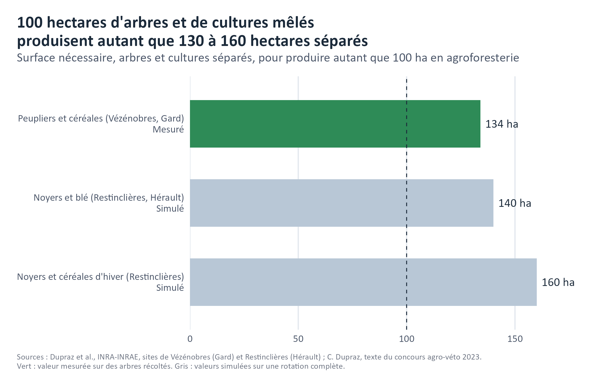
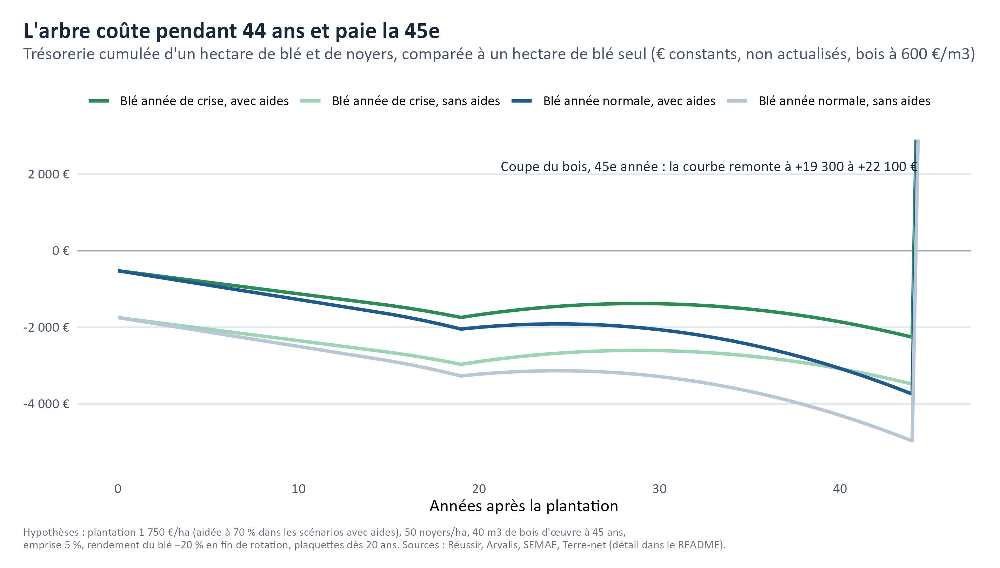
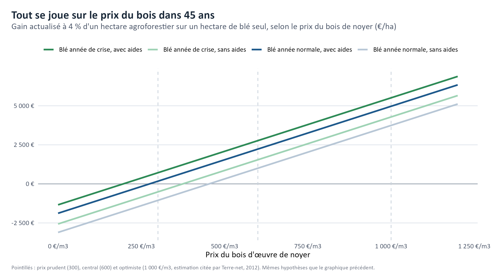
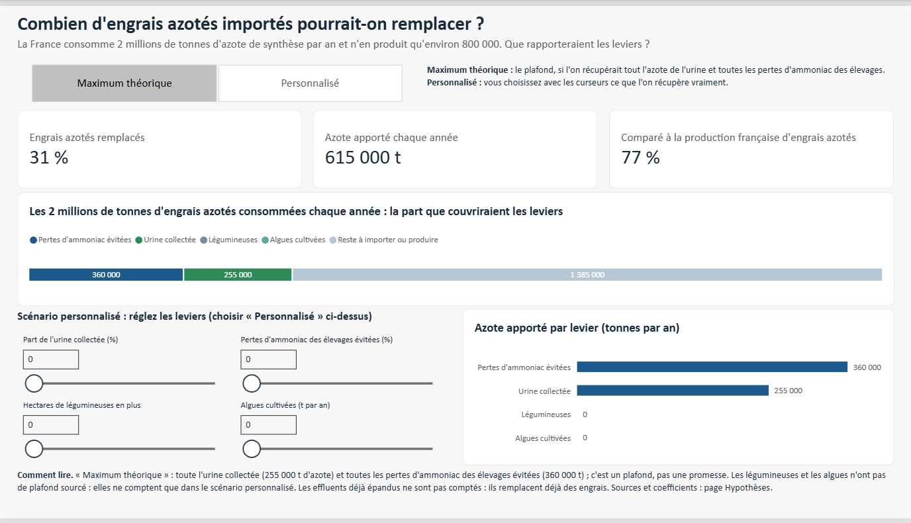

# La France et la terre : l'agriculture 2.0, mêler au lieu de séparer

Ce projet ne cherche pas à dresser l'inventaire d'un déclin ; il s'attache plutôt à chiffrer une autre façon de produire.
Le rendement du blé ne progresse plus depuis trente ans et la France importe l'essentiel de ses engrais, si bien
qu'intensifier encore la monoculture reviendrait surtout à importer davantage. La thèse défendue ici est donc qu'il faut
**mêler à nouveau ce que l'agriculture moderne a séparé**, c'est-à-dire l'arbre et la culture, la culture et l'animal, le
champ et l'eau. C'est ce que le projet appelle l'agriculture 2.0, dont l'agroforesterie et la complantation sont les deux
formes principales. Il en mesure d'abord le rendement, puis montre comment la politique agricole les a fait reculer en ne
rémunérant que l'hectare nu. Il passe ensuite en revue les systèmes qui, de la Campanie au Sahel et du Japon au Brésil,
associent encore plusieurs espèces sur le même hectare, avant de recenser ce qui subsiste en France, en particulier les
systèmes qui relient la terre à l'eau et à la mer, comme les étangs de la Dombes, le riz de Camargue, les prés-salés, le
goémon et les claires à huîtres. Il se demande enfin, comme le ferait un banquier, si un hectare agroforestier est
finançable, avec et sans aides, en année normale comme en année de crise. La récupération de l'azote, quant à elle, n'est
traitée qu'en complément.

## 1. Le constat, en deux chiffres

Le rendement du blé français a progressé de 0,12 t/ha par an entre le début des années 1960 et le milieu des années 1990,
passant de 2,9 à 6,6 t/ha. Il stagne depuis, puisque la moyenne de 2020-2024 s'établit à 6,8 t/ha, ce qui correspond à un
gain de 0,004 t/ha par an (FAOSTAT). On peut donc difficilement espérer produire davantage en intensifiant la même technique.


Ce plafonnement est d'autant plus préoccupant que les engrais viennent désormais de l'étranger. Au début des années 1960,
la France produisait 120 % de l'azote et 193 % de la potasse qu'épandaient ses agriculteurs. Elle ne produit plus
aujourd'hui que 9 % du phosphate et aucune potasse, tandis que, pour l'azote, la part produite sur le territoire varie de
18 % selon FAOSTAT à environ 35 % selon FranceAgriMer (800 000 t produites pour 2 millions de tonnes consommées). Quelle que
soit la source retenue, l'essentiel est importé, de sorte que tout gain de rendement obtenu par les engrais dépend lui aussi
de l'étranger.


## 2. Ce que l'on a séparé

Pendant des siècles, l'agriculture française a associé sur la même parcelle des arbres, des cultures et des animaux, qu'il
s'agisse de vignes grimpant aux arbres fruitiers, de vaches pâturant sous les pommiers ou de haies entourant les champs. La
mécanisation, le remembrement et la spécialisation ont progressivement dissocié ces éléments, en reléguant l'arbre à la
forêt et en réservant le champ à une seule espèce.

Les surfaces en témoignent. Les grandes cultures (céréales, oléagineux, protéagineux) couvrent 11,1 millions d'hectares,
alors que l'agroforesterie moderne, qui consiste à planter des arbres dans des parcelles cultivées, ne dépassait pas
1 000 hectares en 2006 (Dupraz, cité par Agra Valor) et n'en couvrait encore que 10 000 à 15 000 vers 2015, soit environ
**0,1 %** des grandes cultures. Si l'on y ajoute les systèmes traditionnels, comme les prés-vergers et les alignements
d'arbres, on atteint environ 170 000 hectares (J.-J. Dubois, 2016). Il faut d'ailleurs noter qu'aucun recensement officiel
récent ne mesure l'agroforesterie, ce qui en dit long sur la place qu'on lui accorde.


Le recul est également très net. Les prés-vergers, où les vaches pâturent sous des pommiers haute-tige, couvraient 500 000
à 600 000 hectares vers 1930-1950 ; il en reste aujourd'hui entre 100 000 et 165 000 selon les sources (GRAB, 2024 ; plan
national de 2015), et les prés-vergers et bosquets perdaient encore 21 000 hectares par an entre 2012 et 2014 (Solagro).
Quant aux haies, leur longueur est passée de 1 244 000 km en 1975 à 708 000 km en 1987 (Pointereau, 2002), soit une baisse
de 43 % en douze ans au plus fort du remembrement ; au total, elles ont perdu 70 % de leur longueur depuis 1950 (annexe).

## 3. Pourquoi l'arbre a quitté les champs : la PAC payait l'hectare nu

Le recul de l'arbre ne s'explique pas par une productivité moindre. Il tient bien davantage aux règles publiques qui,
pendant un demi-siècle, ont rémunéré la parcelle d'une seule culture et considéré l'arbre comme une surface perdue.

Dès 1953, une politique d'arrachage des pommiers, suivie dans les années 1970 de l'abandon des quotas d'État, a conduit
les producteurs normands à remplacer les pommiers haute-tige des prés-vergers par des vergers basse-tige (CESER Normandie,
2024). Le remembrement des années 1955-1975 a ensuite achevé le mouvement, puisque les travaux qui l'accompagnaient
supprimaient haies et arbres isolés afin d'agrandir les parcelles.

La réforme de la PAC de 1992 a renforcé cette logique. Elle remplace en effet le soutien des prix par des « paiements
compensatoires » versés à l'hectare de céréales, d'oléagineux et de protéagineux (règlement 1765/92), et refuse ces
paiements aux terres qui étaient, au 31 décembre 1991, en prairie permanente, en cultures permanentes ou en forêt (réponse
ministérielle au Sénat, 1999). Le dispositif récompense donc précisément ce que l'agroforesterie cherche à défaire, à savoir
une culture annuelle unique sur une surface sans arbre ; une parcelle plantée était, au mieux, une surface dont on déduisait
les arbres.

Il faut attendre un arrêté du 31 octobre 2006 pour que l'admissibilité des parcelles agroforestières soit enfin fixée. En
dessous de 50 arbres par hectare, la parcelle reste aidée sur toute sa surface ; au-delà, la surface occupée par les arbres
est déduite (réponse ministérielle à l'Assemblée nationale). Un agriculteur qui plantait perdait ainsi l'aide sur l'emprise
de ses arbres, alors que le bois ne lui rapporterait qu'au bout de vingt à cinquante ans. Ce seuil a depuis été porté à
100 arbres par hectare (guide d'admissibilité PAC 2024).

Un retournement s'amorce toutefois à partir de 2015. L'agroforesterie est alors reconnue comme surface d'intérêt
écologique, des aides à la plantation apparaissent, et le plan national de développement de l'agroforesterie se fixe
l'objectif de 122 000 hectares en 2035, soit dix fois la surface de 2015. Un tel retard ne se rattrape cependant pas
rapidement, car un arbre planté en 2015 ne donnera son bois que vers 2050.

## 4. Le gain : produire plus sur le même hectare

Ce gain repose sur le fait que l'arbre et la culture n'exploitent pas les mêmes ressources au même endroit ni au même
moment. Comme l'explique Christian Dupraz, la céréale d'hiver assèche le sol de surface au printemps, ce qui oblige l'arbre à
s'enraciner plus profondément, sous la culture. D'après les simulations de l'INRAE, une parcelle associant noyers et blé
intercepte ainsi, sur 40 ans, 1,39 fois la lumière et valorise 1,55 fois l'eau d'une parcelle spécialisée.

Pour mesurer ce gain, on utilise la surface équivalente (*land equivalent ratio*, LER), qui indique la surface nécessaire
pour produire autant que l'hectare associé si l'on cultivait séparément les arbres et les cultures. Sur les parcelles de
l'INRAE dirigées par Christian Dupraz, elle atteint **1,34** dans un essai mesuré (peupliers et céréales récoltés après 13 à
15 ans, à Vézénobres, dans le Gard) et **1,4 à 1,6** en simulation sur une rotation complète de noyers et de blé
(Restinclières, Hérault). Autrement dit, cent hectares en agroforesterie produisent autant de grain et de bois que 130 à
160 hectares conduits séparément.



Sur le plan technique, les parcelles de l'INRAE comptent 80 noyers par hectare à Restinclières, et 140 peupliers par hectare
à Vézénobres, contre 200 en peupleraie pure. Les rangées y sont suffisamment espacées pour laisser passer les machines, ce
qui distingue l'agroforesterie moderne des systèmes anciens, dont beaucoup ont été abandonnés faute de pouvoir y faire
circuler un tracteur.

La densité des arbres joue néanmoins un rôle décisif. En Chine, dans la plaine du fleuve Jaune, où le blé est cultivé entre
des rangées de paulownias, une étude de 1997 montre que le rendement du blé augmente tant que les arbres couvrent moins de
28 % de la parcelle, avec un optimum vers 14 %, puis diminue au-delà ; dans une parcelle plus dense, une étude de 2008 relève
même un blé 51 % moins productif qu'en plein champ. L'association n'est donc pas gagnante par principe, et elle demande à être
réglée avec autant de soin qu'une dose d'engrais.

Les arbres jouent enfin un rôle de protection, puisque leurs racines descendent sous la zone exploitée par la culture et y
interceptent les nitrates qui, sans elles, gagneraient la nappe. L'INRAE modélise cet effet dans le projet METAGROFORESTRY,
mais aucune mesure publique n'en donne encore l'ampleur à l'échelle d'une parcelle française.

## 5. Ce qui subsiste en France, de la terre à la mer

La France conserve néanmoins des systèmes qui associent plusieurs espèces, et une partie d'entre eux relient précisément la
terre à l'eau, jusqu'à la mer, ce qui fait le lien entre ce projet et le précédent.

### À terre : l'arbre et la culture

La joualle du Sud-Ouest associait sur la même parcelle « de la vigne poussant sur des arbres fruitiers et plusieurs autres
cultures intercalaires », réparties en trois étages :
- **les arbres**, choisis selon le sol et le climat et renouvelés rang par rang, comme les pêchers de vigne dans les
  Charentes, les cerisiers en Gironde, les pruniers d'Ente en Lot-et-Garonne et en Périgord, ou les abricotiers sur les
  coteaux du Lot et de la Garonne ;
- **la vigne**, qui grimpait dans ces arbres utilisés comme « tuteurs vivants » ;
- **entre les rangs**, des bandes au moins aussi larges que le passage d'un attelage de bœufs, parfois jusqu'à 15 mètres,
  semées de légumes, de céréales (avoine, blé, orge, sarrasin), de fourrage, de betteraves, puis de pommes de terre ou de
  tabac.

Le même hectare fournissait ainsi du vin, des fruits, du grain et du fourrage pour les bêtes de trait. La joualle était en
somme conçue pour l'outil de son temps, l'attelage, de la même manière que l'agroforesterie de l'INRAE l'est pour le tracteur.

Ce système est très ancien, puisque Virgile, dans les *Géorgiques*, conseille déjà de « marier la vigne à l'ormeau ». Il
était d'ailleurs si répandu que la « joualée de vigne » devient une mesure de surface dès 1340. Son recul s'est fait en
trois temps. Au XVIIIe siècle, l'agronome abbé Rozier le condamne en affirmant que « tout arbre nuit à la vigne, autant par
son ombrage que par ses racines ». En 1851, l'oïdium, apparu à Cartelègue dans le Blayais, « sonne le glas » des joualles du
Bordelais, qui se maintiennent toutefois plus au nord, dans les Charentes. Au XXe siècle enfin, la joualle se réduit à une
alternance de rangs de vigne et de bandes de blé jusqu'aux années 1960, avant que le remembrement ne fasse disparaître « la
quasi-totalité des dernières joualles ». Elle survit en revanche hors de France, en Galice et surtout dans le Minho
portugais, la région du *vinho verde*.

Ce déclin illustre bien l'ensemble du projet, puisqu'il enchaîne une condamnation savante, un choc sanitaire, puis les
effets conjugués de la machine et de la réglementation. Les mesures de l'INRAE donnent pourtant aujourd'hui tort à l'abbé
Rozier, car lorsque la densité est bien réglée, l'arbre ne retire pas à la culture davantage qu'il n'apporte par sa propre
production.

Plus haut, dans le Comminges et le Béarn, les **hautains** faisaient de même monter la vigne sur des arbres vivants,
au-dessus des cultures, selon un principe proche de la *vite maritata* italienne décrite plus loin.

En Normandie, les **prés-vergers** associent quant à eux pommes à cidre, herbe et lait, puisque les vaches pâturent sous des
pommiers haute-tige plantés à moins de 100 arbres par hectare, alors qu'un verger moderne peut en compter jusqu'à 3 000
(GRAB). Ce système est passé de 500 000 à environ 100 000 hectares en moins d'un siècle. L'Allemagne en a mieux conservé,
puisque ses *Streuobstwiesen* couvrent encore 300 000 à 400 000 hectares selon les estimations.

### Au bord de l'eau douce : le champ et l'étang

Depuis le Moyen Âge, les **étangs de la Dombes** (Ain) alternent deux années d'« évolage », pendant lesquelles ils restent en
eau pour l'élevage des carpes, des tanches et des brochets, et une année d'« assec », où ils sont vidés et semés d'avoine ou
de maïs. Le poisson fertilise le fond de l'étang, la céréale en tire parti, puis l'eau revient sur un sol nettoyé. Ce
système rejoint donc celui de la rizière à poissons chinoise, à ceci près qu'il procède par rotation plutôt que par
association simultanée. Il reste aujourd'hui environ 1 100 à 1 200 étangs sur 11 200 hectares, contre près de 20 000 hectares
au milieu du XIXe siècle (APPED ; ministère de la Culture).

En **Camargue**, le riz joue un rôle qui dépasse la simple production, car l'eau douce qui l'inonde lessive le sel remontant
de la mer et rend ainsi la terre cultivable les années suivantes. Il alterne avec le blé dur et la luzerne, et les fermes y
associent souvent un élevage de taureaux ou de moutons dont le fumier retourne aux champs ; en agriculture biologique, une
année de riz alterne d'ailleurs avec au moins quatre années de cultures sèches (INRAE). La surface en riz est passée
d'environ 32 000 hectares en 1962 à moins de 5 000 en 1981, avant de remonter à 21 000 en 2012 puis de retomber à environ
11 500 (FranceAgriMer, 2024).

Entre Niort et la mer, le « marais mouillé » du **Marais poitevin** forme une sorte de bocage d'eau, où les prairies,
pâturées ou fauchées, sont bordées de canaux et de frênes taillés en têtard, dont on récoltait les branches pour le bois et
le fourrage. Il en reste près de 400 000. L'inventaire de 2001 estimait toutefois qu'il manquait déjà près des trois quarts
des arbres plantés à l'origine, et la chalarose, une maladie du frêne, les décime aujourd'hui, si bien que 17 000 arbres ont
dû être replantés depuis 2017 (parc naturel régional ; Natura 2000).

### Au contact de la mer : ce que la mer donne à la terre

Dans les baies du Mont-Saint-Michel et de la Somme, des moutons pâturent les herbus que la marée recouvre régulièrement.
L'herbe salée, nourrie par les sédiments marins, y est ainsi transformée en viande sans engrais ni culture, et chacune des
deux baies dispose de sa propre appellation d'origine protégée. La baie du Mont-Saint-Michel produit 8 000 à 10 000 agneaux
de **prés-salés** par an, dont environ 1 500 sous appellation (*Réussir*, 2024).

Sur la côte du Léon, autour de Roscoff et de Saint-Pol-de-Léon, les paysans ont longtemps fertilisé leurs champs avec le
**goémon** ramassé sur les grèves et avec le maërl, un sable calcaire formé d'algues. Ce sont précisément ces terres,
enrichies par la mer, qui ont donné naissance vers 1880 à la « ceinture dorée » des légumes bretons (artichauts,
choux-fleurs, oignons). L'épandage d'algues y est certes devenu minoritaire, mais la ressource demeure, puisque Lanildut,
premier port goémonier d'Europe, débarque environ 35 000 tonnes d'algues par an, aujourd'hui destinées surtout à
l'industrie.

À **Marennes-Oléron**, enfin, lorsque le sel de l'Atlantique a cessé d'être rentable, les ostréiculteurs charentais ont
repris les marais salants abandonnés pour en faire des « claires », c'est-à-dire des bassins d'argile où les huîtres sont
affinées. Environ 3 000 hectares de claires produisent aujourd'hui une huître sous indication géographique protégée, à
hauteur d'environ 17 000 tonnes par an. On a donc réemployé un ouvrage aménagé sur la terre pour exploiter le sel marin au
profit d'un autre usage de la mer.

| Système | Région | Ce qui est mêlé | Surface ou volume | Tendance |
|---|---|---|---|---|
| Prés-vergers | Normandie, Bretagne | pommiers + herbe + vaches | 100 000 à 165 000 ha | en recul |
| Joualles et hautains | Sud-Ouest, Pyrénées | vigne + fruitiers + céréales | non chiffré | quasi disparus |
| Étangs de la Dombes | Ain | poissons puis céréales | 11 200 ha, 1 100 à 1 200 étangs | 20 000 ha vers 1850 |
| Riz de Camargue | Bouches-du-Rhône, Gard | riz + blé dur + luzerne + taureaux | environ 11 500 ha | moitié de 2012 |
| Marais poitevin | Vendée, Deux-Sèvres, Charente-Maritime | frênes têtards + prairies + bétail | près de 400 000 têtards | chalarose |
| Prés-salés | Mont-Saint-Michel, Somme | herbus marins + moutons | 8 000 à 10 000 agneaux/an | stable, deux AOP |
| Goémon et ceinture dorée | Léon | algues et maërl + légumes | 35 000 t d'algues à Lanildut | épandage minoritaire |
| Claires | Marennes-Oléron | anciens marais salants + huîtres | 3 000 ha, 17 000 t/an | menacées par la chaleur l'été |

## 6. Ailleurs : onze systèmes qui mêlent

L'agriculture 2.0 n'invente donc rien ; elle redécouvre des systèmes qui ont fait leurs preuves et s'attache à les mesurer.
Les onze exemples suivants sont classés par continent.

**En Europe.**
- **L'alberata aversana (Campanie).** Entre Naples et Caserte, la vigne d'asprinio est « mariée » à des peupliers et monte
  jusqu'à 7 à 15 mètres, si bien qu'on la vendange sur de hautes échelles, tandis que le sol reste libre pour d'autres
  cultures. Héritière de la *vite maritata* des Étrusques, elle couvrait plus de 16 000 hectares en 1960 ; il n'en reste
  que quelques centaines (Italia Nostra), aujourd'hui protégées par un présidium Slow Food.
- **La dehesa et le montado (Espagne, Portugal).** Environ 3,5 millions d'hectares de prairies plantées de chênes
  fournissent sur le même sol de l'herbe, du liège, du bois et des glands, que les porcs ibériques viennent consommer à
  l'automne, et dont les déjections fertilisent en retour la prairie. Le décret de 2014 sur le porc « de bellota » impose
  d'ailleurs au moins 46 kg pris à la glandée en plus de 60 jours, et limite la charge à 0,25 à 1,25 porc par hectare selon
  la couverture des arbres. Environ 700 000 porcs étaient certifiés par saison au milieu des années 2010.

**En Afrique.**
- **L'arbre qui perd ses feuilles à la saison des pluies (Malawi, Zambie).** Contrairement aux autres arbres, *Faidherbia
  albida* perd ses feuilles au début de la saison des pluies ; il ne fait donc pas d'ombre au maïs pendant sa croissance,
  puis enrichit le sol en azote et en matière organique grâce à ses feuilles tombées. En Zambie, la FAO relève ainsi
  4,7 t/ha de maïs sous les arbres, contre 1,9 t/ha hors de leur couvert, et les services agricoles du Malawi et de la
  Zambie recommandent une centaine d'arbres par hectare.
- **La régénération naturelle au Niger.** Plutôt que de planter, les paysans du sud du Niger laissent repousser, puis
  taillent, les souches d'arbres qui subsistent dans leurs champs. Cette pratique s'est étendue à environ 5 millions
  d'hectares et quelque 200 millions d'arbres (partenariat des Nations unies), et les mesures locales relèvent des
  rendements de mil plus élevés à proximité des arbres.
- **L'oasis à trois étages (Maghreb).** Le palmier dattier occupe l'étage supérieur, où il fait de l'ombre et coupe le
  vent ; les fruitiers (abricotier, grenadier, figuier, olivier) occupent l'étage intermédiaire, tandis que le fourrage, les
  légumes et les céréales poussent au sol. Les oasis de palmiers couvrent environ 500 000 hectares dans la région et font
  vivre plus de cinq millions de personnes (CIRAD) ; leur principale menace est d'ailleurs leur conversion en monoculture
  de palmiers.

**En Asie.**
- **La rizière à poissons (Qingtian, Chine).** On y élève des carpes dans les rizières depuis plus de mille ans ; les
  poissons consomment les insectes et les mauvaises herbes tout en fertilisant l'eau. Ce système figure parmi les premiers
  reconnus en 2005 par la FAO comme « patrimoine agricole mondial », notamment en raison de la baisse des pesticides et des
  engrais qu'il permet.
- **La rizière à canards (Japon).** La méthode *aigamo*, popularisée par Takao Furuno, consiste à lâcher dans la rizière
  des canetons de sept jours, à raison de 15 à 30 pour 1 000 m², puis à les retirer au bout de huit semaines. Ils mangent
  les mauvaises herbes et les insectes, et leurs fientes fertilisent la parcelle. Environ 10 000 agriculteurs japonais
  l'appliquent, et Furuno lui-même vend riz, canards, œufs et légumes produits sur 3,2 hectares.
- **Le blé sous les paulownias (Chine).** Ce système, déjà évoqué plus haut, est répandu dans la plaine du fleuve Jaune et
  montre que le gain dépend étroitement de la densité des arbres.
- **Le jardin-forêt kandyen (Sri Lanka).** Sur des parcelles de 0,4 hectare en moyenne se superposent plusieurs étages
  d'arbres à bois, de fruitiers (jacquier, manguier), de plantes d'exportation (poivre, girofle, café) et de plantes
  médicinales. Une étude y dénombre, par hectare, 73 arbres à bois, 193 fruitiers, 300 plantes médicinales et 147 plantes
  d'exportation, dans un système pratiqué depuis plusieurs siècles.

**En Amérique.**
- **La cabruca (Bahia, Brésil).** Le cacao y pousse sous les grands arbres de la forêt atlantique, dont on n'a éclairci que
  le sous-bois, avec 35 à 355 arbres d'ombrage par hectare selon les parcelles. Environ 70 % des quelque 650 000 hectares de
  cacao de Bahia seraient conduits de cette manière, et la loi de l'État impose depuis 2014 d'y conserver au moins
  20 arbres natifs par hectare.
- **Le pâturage arboré intensif (Colombie, Mexique).** Les vaches y pâturent entre des rangs serrés de *Leucaena*, un
  arbuste fourrager qui fixe l'azote de l'air, planté à plus de 10 000 pieds par hectare sous des arbres à bois. Les
  comparaisons publiées font état de 1,5 à 5 fois plus de lait par hectare et par jour que dans les prairies classiques
  (Murgueitio et al., 2011).

| Système | Pays | Ce qui est mêlé | Surface | Gain ou fait chiffré |
|---|---|---|---|---|
| Agroforesterie INRAE | France | noyers ou peupliers + céréales | quelques dizaines d'ha d'essais | LER 1,34 mesuré, 1,4 à 1,6 simulé |
| Prés-vergers | France, Allemagne | pommiers + herbe + vaches | 100 000 ha (FR), 300 000 à 400 000 ha (DE) | moins de 100 arbres/ha |
| Alberata aversana | Italie | vigne + peupliers + cultures | 16 000 ha en 1960, quelques centaines aujourd'hui | vigne de 7 à 15 m |
| Dehesa | Espagne, Portugal | chênes + herbe + porcs | environ 3,5 millions d'ha | 0,25 à 1,25 porc/ha |
| *Faidherbia albida* | Zambie, Malawi | arbre + maïs | — | 4,7 contre 1,9 t/ha de maïs |
| Régénération naturelle | Niger | arbres + mil | environ 5 millions d'ha | 200 millions d'arbres |
| Oasis à trois étages | Maghreb | palmier + fruitiers + cultures | environ 500 000 ha | 5 millions d'habitants |
| Rizière à poissons | Chine | riz + carpes | — | patrimoine agricole mondial (FAO, 2005) |
| Rizière à canards | Japon | riz + canards | environ 10 000 fermes | 15 à 30 canetons pour 1 000 m² |
| Blé sous paulownias | Chine | paulownias + blé | — | gain si arbres sous 28 % de couverture |
| Jardin kandyen | Sri Lanka | 4 étages d'arbres et de plantes | parcelles de 0,4 ha | plus de 700 plantes utiles/ha |
| Cabruca | Brésil | cacao + arbres de forêt | environ 450 000 ha | 35 à 355 arbres/ha |
| Pâturage arboré intensif | Colombie, Mexique | *Leucaena* + herbe + vaches | — | 1,5 à 5 fois plus de lait/ha |

## 7. Ce que ces systèmes enseignent

Ces systèmes ont d'abord en commun de produire plusieurs choses sur le même hectare (grain, bois, fruits, lait, viande), et
c'est bien ce total, plutôt que le rendement d'une seule culture, qu'il convient de comparer. Ils recyclent en outre sur
place ce que la monoculture doit acheter, qu'il s'agisse de l'azote (apporté par les fientes, les déjections ou les arbres
fixateurs), du désherbage (assuré par les canards, les poissons ou les porcs) ou de la protection contre le vent et la
chaleur (offerte par le palmier ou le paulownia). Ils supposent par ailleurs un réglage précis de la densité d'arbres ou du
nombre d'animaux par hectare, faute de quoi le rendement de la culture baisse. Enfin, leur recul tient moins à leur
productivité qu'à deux facteurs extérieurs, à savoir leur difficile adaptation à la machine et une politique agricole qui
rémunérait l'hectare d'une seule culture.

L'apport de la recherche consiste précisément à les rendre compatibles avec la machine, en espaçant les rangées d'arbres
pour le passage des engins, en choisissant des essences pour la valeur de leur bois et en mesurant les densités. Ce qui fait
défaut en France, c'est donc avant tout l'échelle, puisque l'agroforesterie moderne n'y couvre que 10 000 à 15 000 hectares
pour 11 millions d'hectares de grandes cultures.

On remarque en outre que les systèmes français qui ont le mieux résisté sont ceux qui vivent au contact de l'eau, comme la
Dombes, la Camargue, le Marais poitevin, les prés-salés ou les claires. L'eau y imposait en effet d'associer les usages, et
la machine ne pouvait pas tout dissocier. Ces exemples confirment ce que le projet précédent sur la mer laissait entrevoir,
à savoir que la terre et la mer forment une seule et même économie : la mer nourrit l'herbe des prés-salés et les champs du
Léon, tandis que la terre, par ses fleuves, nourrit les huîtres des claires. Les séparer revient donc à perdre de part et
d'autre.

## 8. Est-ce finançable ? Un hectare de blé contre un hectare de blé et de noyers

Si l'agroforesterie produit davantage par hectare, un agriculteur, comme la banque qui lui prête, raisonne d'abord en
trésorerie. Le modèle compare donc, année par année sur 45 ans, un hectare de blé seul et un hectare de blé planté de
50 noyers, avec et sans aides publiques, en année normale et en année de crise.

Les hypothèses, toutes sourcées, peuvent être modifiées en tête de la section 14 d'`analyse.R` :

| Paramètre | Valeur | Source |
|---|---|---|
| Produit du blé | 1 500 €/ha (moyenne 2019-2023) ; 1 200 €/ha en crise (2025) | Arvalis, cité par *Réussir* |
| Charges du blé | 1 600 €/ha, dont 31 % d'intrants, seuls économisés sous les arbres | Arvalis (2025) ; SEMAE (2026) |
| Aides PAC | environ 280 €/ha (40 €/t), versées en entier sous 100 arbres/ha | Arvalis ; guide PAC 2024 |
| Plantation | 1 750 €/ha, subventionnée à 70 % avec aides, à 0 % sans | *Réussir*, 2022 (1 500 à 2 000 €, aidés de 50 à 80 %) |
| Arbres | 50 noyers/ha, 20 % de pertes, 1 m3 de bois d'œuvre par arbre, coupe à 45 ans | *Réussir*, 2022 (F. Liagre, Agroof) |
| Culture sous les arbres | 5 % de surface perdue ; rendement en baisse après 15 ans, jusqu'à −20 % | *Réussir*, 2022 |
| Revenus intermédiaires | plaquettes d'élagage dès 20 ans : 22,5 m3/ha/an à 7,5 €/m3 net de broyage | *Réussir*, 2022 |
| Prix du bois de noyer | 300 (prudent), 600 (central), 1 000 €/m3 (optimiste) | *Terre-net*, 2012 (1 000 € « optimiste ») |
| Taux d'actualisation | 4 % (sensibilité 2 % et 6 %) | hypothèse |

Le modèle montre d'abord que le blé seul n'est plus viable sans aides. Avec 1 500 € de produit pour 1 600 € de charges, un
hectare de blé perd en effet 100 € par an sans aides, et 120 € en année de crise même lorsque les aides sont versées, ce qui
rejoint le diagnostic d'Arvalis pour 2025.

L'arbre, en revanche, se révèle rentable, et davantage encore en période de crise. Au prix central du bois, l'hectare
agroforestier rapporte en effet, en valeur actualisée sur 45 ans, de 1 000 à 2 800 € de plus que l'hectare de blé seul.

| Gain actualisé à 4 % (€/ha) | Bois à 300 €/m3 | Bois à 600 €/m3 | Bois à 1 000 €/m3 |
|---|---|---|---|
| Blé normal, avec aides | +170 | **+2 230** | +4 970 |
| Blé normal, sans aides | −1 050 | **+1 000** | +3 740 |
| Blé en crise, avec aides | +720 | **+2 770** | +5 510 |
| Blé en crise, sans aides | −510 | **+1 540** | +4 280 |

Le taux de rendement interne de l'écart s'établit entre 4,8 et 7,0 % au prix central. La crise du blé améliore donc
paradoxalement la position de l'agroforesterie, car le blé perdu sous les arbres vaut alors moins, tandis que le prix du bois
ne dépend pas du marché des céréales. L'arbre joue ainsi le rôle d'une diversification, à la manière d'un actif peu corrélé
au reste d'un portefeuille.

Les aides PAC à l'hectare, quant à elles, ne modifient presque pas l'écart. En dessous de 100 arbres par hectare, la parcelle
plantée touche en effet la même aide qu'un champ nu, de sorte que leur suppression appauvrit les deux hectares dans la même
mesure. La subvention de plantation pèse en revanche nettement plus lourd, puisque sans elle le gain diminue d'environ
1 200 €/ha et le prix du bois nécessaire pour rentrer dans ses frais passe de 275 à 454 €/m3 (de 196 à 375 €/m3 en crise).
Ce calcul éclaire également le passé : si la parcelle plantée perdait toute son aide, comme les terres boisées exclues des
paiements de 1992, la perte atteindrait environ 5 800 €/ha en valeur actualisée (280 € par an pendant 45 ans), soit bien
davantage que le gain apporté par l'arbre.



Le principal frein tient toutefois au calendrier, car la rentabilité arrive trop tard pour être financée par les moyens
habituels. L'écart de trésorerie reste en effet négatif pendant 44 ans et atteint un creux de 2 300 à 5 000 €/ha, l'ensemble
n'étant remboursé qu'au moment de la coupe. Or aucun prêt agricole classique ne court sur 45 ans, et l'agriculteur qui plante
à 40 ans ne vendra probablement pas le bois lui-même. Le projet est donc rentable, mais difficilement finançable par le
crédit ordinaire, puisqu'il s'agit d'un actif de long terme, comparable à une forêt ou à une infrastructure, porté par un
acteur qui raisonne le plus souvent à court terme.



Le taux d'actualisation pèse lui aussi fortement sur le résultat. Au prix central, le gain atteint 7 400 €/ha à 2 %, contre
2 230 € à 4 % et seulement 190 € à 6 %. Pour un actif qui ne paie qu'au bout de 45 ans, le coût de l'argent compte donc
davantage que le prix du bois lui-même.

On voit bien ici que l'enjeu porte moins sur une aide supplémentaire à l'hectare que sur le financement du creux de
trésorerie. Plusieurs instruments pourraient y répondre, comme un prêt de très long terme adossé à la valeur du bois sur
pied, une avance remboursable à la coupe, ou encore la prise en compte de la valeur des arbres dans le prix de la terre lors
d'une vente ou d'une transmission. La question relève par conséquent autant du banquier que de l'agronome.

## 9. En complément : ne plus perdre l'azote que l'on épand

Si l'agriculture 2.0 réduit le besoin d'engrais, elle ne le supprime pas pour autant ; l'autre volet du sujet consiste donc
à ne plus perdre ce que l'on épand.

Cet excès est d'ailleurs bien mesuré. En 2020, 4,2 millions de tonnes d'azote ont été apportées aux terres agricoles
françaises, pour moitié sous forme d'engrais minéraux et pour 40 % sous forme de déjections animales, le reste provenant des
légumineuses et de l'air. Les cultures et les prairies n'en ont toutefois prélevé que 2,7 millions, soit 64 %, tandis que
540 000 tonnes se sont volatilisées, principalement sous forme d'ammoniac, et que 970 000 tonnes sont restées en excédent dans
les sols (INSEE, 2024). L'azote n'est évidemment pas nocif pour les cultures, puisque c'est l'élément dont elles ont le plus
besoin ; le coût provient de l'excès que la plante ne prélève pas et qui rejoint les nappes, les fleuves et l'air.


Les leviers disponibles sont présentés ci-dessous, du plus important au plus modeste.
- **Les pertes d'ammoniac des élevages** représentent environ 360 000 tonnes d'azote par an, soit les deux tiers des pertes
  dans l'air (INSEE). Injecter le lisier dans le sol ou l'enfouir rapidement permet de les réduire de 70 à 90 % (chambres
  d'agriculture, d'après l'ADEME). Ce levier rejoint d'ailleurs la question de l'agriculture mêlée, puisque la France a perdu
  entre 2010 et 2020 30 % de ses fermes de polyculture-élevage, qui épandaient sur leurs champs le fumier de leurs propres
  bêtes.
- **Les légumineuses** (pois, féverole, luzerne, trèfle) fixent l'azote de l'air, si bien qu'un blé semé après un pois
  demande 20 à 60 kg d'azote de moins par hectare (DRAAF Grand Est, d'après Terres Inovia).
- **L'urine** contient 85 % de l'azote de nos excréments, que les stations d'épuration renvoient pour l'essentiel dans
  l'air. Sur environ 300 000 tonnes excrétées, 10 % seulement reviennent ainsi aux cultures (Starck, Fardet et Esculier,
  LEESU, 2023), alors qu'une collecte séparée permettrait de remplacer environ 15 % des engrais azotés de synthèse. Victor
  Hugo l'écrivait déjà en 1862 : « Si notre or est fumier, en revanche, notre fumier est or. »
- **Le pilotage de la dose** a permis, dans neuf essais conduits en Centre-Val de Loire avec la méthode APPI-N de l'INRAE et
  d'Arvalis, de réduire la dose de 33 kg d'azote par hectare sans perte significative de rendement.
- **Les cultures intermédiaires** semées entre deux récoltes réduisent de plus de moitié le nitrate des eaux de drainage
  (INRA, 2012).
- **La mer cultivée** (algues, moules) peut rendre un peu d'azote aux champs, mais elle n'en retire qu'environ 1 000 tonnes,
  alors que les fleuves y en apportent 607 000 chaque année (SDES) ; elle reste donc un complément plutôt qu'une solution.

Le détail de ces chiffres (boues d'épuration par pays, devenir de l'azote des excréments, ordres de grandeur marins) figure en
annexe.

## 10. Ce que cela donne ensemble

| Levier | Gain chiffré | Délai | Limite principale |
|---|---|---|---|
| Agroforesterie | 1,3 à 1,6 fois la production d'un hectare spécialisé ; +1 000 à +2 800 €/ha actualisés au prix central du bois | 15 à 50 ans pour le bois | creux de trésorerie de 2 300 à 5 000 €/ha pendant 44 ans ; densité à régler |
| Complantation et pâturage arboré | jusqu'à 1,5 à 5 fois plus de lait/ha (Colombie) ; maïs 4,7 contre 1,9 t/ha (Zambie) | quelques années | résultats obtenus sous d'autres climats |
| Prés-vergers | herbe, lait et fruits sur le même hectare | plusieurs années | passage des machines, marché du cidre |
| Pertes d'ammoniac des élevages | jusqu'à 360 000 t d'azote par an ; 70 à 90 % évitables à l'épandage | immédiat | matériel, coût, distance élevages-cultures |
| Légumineuses | 20 à 60 kg d'azote en moins par hectare sur le blé suivant | une rotation | débouchés et rendements à sécuriser |
| Séparation de l'urine | jusqu'à 15 % des engrais azotés de synthèse | dès les constructions neuves | réseaux à créer, collecte |

Qu'il s'agisse de la mer, du fleuve ou de la terre, le savoir-faire existe donc, et il est souvent français, comme le
montrent GTT pour les cuves des méthaniers ou l'INRAE pour l'agroforesterie. La difficulté réside davantage dans sa mise en
œuvre, qui fera l'objet du projet suivant.

## Simulateur Power BI

Le simulateur porte sur le complément présenté en section 9, seul volet du projet qui se prête à une addition de tonnes.
Le dossier `powerbi/` contient en effet un simulateur interactif (format PBIP, à ouvrir avec Power BI Desktop) construit
autour d'une seule question : **combien d'engrais azotés importés pourrait-on remplacer ?** Une grande jauge représente les
2 millions de tonnes d'azote de synthèse consommées chaque année, que l'on remplit levier par levier, et trois indicateurs
donnent l'azote apporté, la part des engrais remplacée et la comparaison avec la production française (800 000 t).



Deux scénarios sont proposés. Le premier, intitulé **« Maximum théorique »**, suppose que toute l'urine est collectée
(255 000 t d'azote) et que toutes les pertes d'ammoniac des élevages sont évitées (360 000 t), ce qui représente 615 000 t,
soit 31 % des engrais azotés consommés et 77 % de la production française ; il s'agit bien sûr d'un plafond plutôt que d'un
objectif. Le second, **« Personnalisé »**, permet de régler par quatre curseurs la part de l'urine collectée, la part des
pertes d'ammoniac évitées, les hectares de légumineuses supplémentaires et les tonnes d'algues cultivées. Les légumineuses
et les algues n'entrent pas dans le maximum, faute de plafond sourcé. Une page compare par ailleurs les pays européens sur
leurs boues d'épuration, et une autre liste chaque coefficient avec sa source. Dans l'exemple ci-dessous, 40 % de l'urine
collectée, 45 % des pertes d'ammoniac évitées, un million d'hectares de légumineuses supplémentaires et 300 000 tonnes
d'algues apportent 305 350 tonnes d'azote, soit 15 % des engrais azotés consommés.


Sur le plan technique, chaque curseur est un paramètre de simulation (`GENERATESERIES`, `SELECTEDVALUE` avec valeur par
défaut), et les coefficients sont des mesures constantes regroupées dans un dossier « Hypothèses », de sorte qu'une
hypothèse ne se modifie qu'à un seul endroit. Les pourcentages sont stockés en entiers (de 0 à 100) afin que le filtre d'un
curseur retrouve toujours sa valeur exacte, et les cartes affichent un texte déjà formaté (« 615 000 t ») plutôt que les
abréviations par défaut. Les calculs ont enfin été vérifiés par des requêtes DAX sur le modèle.

## Limites

- **Le plateau du blé a plusieurs causes** (choix variétaux, réduction des intrants, aléas de récolte) ; ce projet le
  constate, il ne les départage pas.
- **Le LER mesuré l'a été sur peu de parcelles** : 1,34 provient d'un essai de peupliers ; 1,4 à 1,6 sont simulés.
- **L'usage agricole d'engrais publié par la FAO est irrégulier entre 2003 et 2014** ; seules les périodes 1961-1965 et
  2020-2024 sont comparées.
- **Le bilan de l'azote des excréments** porte sur 2015-2020, avec une part recyclée estimée entre 5 et 15 %. Le chiffre
  parfois cité d'un recyclage de 50 % de l'azote parisien vers 1904 n'a pas pu être vérifié à la source ; il n'est pas repris.
- **Les champs d'épandage ont laissé des sols pollués** au plomb, parce que les eaux mêlaient rejets domestiques et
  industriels (suivi de l'ARS Île-de-France). La séparation à la source répond aussi à ce problème.
- **Les coefficients marins sont des ordres de grandeur.** 13,7 kg d'azote par tonne vient de moules danoises dites « de
  compensation », récoltées jeunes ; les moules de bouchot françaises peuvent s'en écarter. 4,5 kg par tonne d'algues vient
  de deux essais danois de laminaire sucrée cultivée (environ 23 g d'azote pour 5,1 kg de biomasse par mètre de filière ;
  5 à 7 g pour 1,1 à 1,5 kg dans un essai antérieur), connus par leurs résumés, et appliqué ici aux laminaires sauvages.
- **Le bilan de l'azote des excréments est une prépublication** (arXiv, 2023), sans publication connue dans une revue à
  comité de lecture ; ses auteurs (LEESU, École des Ponts) sont toutefois les spécialistes français du sujet. Le flux des fleuves est une moyenne
  décennale publiée par le SDES. L'effet des huîtres n'est pas compté.
- **La dehesa est mal mesurée** : sa surface varie de 0,5 à plus de 3,5 millions d'hectares selon la définition ; le chiffre
  de 700 000 porcs date d'une saison du milieu des années 2010.
- **Production française d'engrais azotés : deux sources discordantes.** FAOSTAT donne 343 000 t (moyenne 2020-2024),
  FranceAgriMer 800 000 t (2025) ; la série FAO présente une rupture vers 2012. Le graphique des engrais repose sur FAOSTAT ;
  la potasse (0 %) et le phosphate (9 %) ne sont pas en cause.
- **Les leviers ne s'additionnent pas.** Effluents, urine, légumineuses et cultures intermédiaires portent sur des flux
  d'azote qui se recouvrent en partie ; leurs gains ne peuvent pas être sommés.
- **Les effluents déjà épandus ne sont pas comptés comme un levier** : ils remplacent déjà des engrais. Seules leurs
  pertes d'ammoniac le sont (environ 360 000 t, deux tiers des 540 000 t volatilisées selon l'INSEE). Les taux de réduction
  par injection ou enfouissement (70 à 90 %) viennent de fiches de chambres d'agriculture reprenant l'ADEME.
- **Deux mesures des déjections animales.** L'INSEE compte 1,68 million de tonnes d'azote dans les déjections (y compris au
  pâturage) ; FranceAgriMer, 597 500 tonnes dans les seuls fumiers et lisiers collectés. Les deux chiffres ne mesurent pas
  la même chose.
- **Le gain de la méthode APPI-N** repose sur neuf essais régionaux (2017-2019) ; il n'est pas généralisable tel quel.
- **L'agroforesterie n'a pas de recensement officiel récent.** Les surfaces (10 000 à 15 000 ha d'agroforesterie moderne,
  170 000 ha de systèmes traditionnels) datent de 2015-2016 ; celles des prés-vergers varient de 100 000 à 165 000 ha selon
  les sources. Les grandes cultures ne sont pas toutes des monocultures au sens strict : elles tournent d'une année sur
  l'autre, mais chaque parcelle porte une seule espèce à la fois.
- **La complantation historique n'est pas chiffrée** : aucune statistique ne mesure l'étendue passée des joualles Leur
  histoire repose sur l'article Wikipédia, dont les notes sont incomplètes ; sa mention d'une survivance en Galice et
  dans le Minho n'a pas été vérifiée par ailleurs.
- **Les systèmes français au contact de l'eau sont chiffrés par des sources de filière.** Le nombre d'étangs de la Dombes
  varie de 1 100 à 1 200 selon les sources ; la surface en riz de Camargue varie fortement d'une année à l'autre ; aucune
  source trouvée ne donne la surface des herbus pâturés ni le tonnage d'algues épandu sur les champs du Léon ; le chiffre de
  3 000 hectares de claires désigne parfois les claires seules, parfois les claires et les parcs.
- **Le modèle financier est un ordre de grandeur, pas un plan d'affaires.** Ses paramètres viennent pour l'essentiel
  d'articles de presse agricole (*Réussir*, *Terre-net*) citant des experts, non de comptabilités réelles ; le prix du bois
  de noyer dans 45 ans est inconnu, d'où trois scénarios ; les charges du blé (1 600 €/ha) sont une moyenne nationale
  de 2025, et la part des intrants (31 %) vient d'une enquête régionale ; l'entretien des arbres (25 €/ha/an) reprend une
  évaluation faite pour les haies. Le modèle ne compte ni l'effet des arbres sur l'azote, l'érosion ou les années sèches,
  ni la valeur du foncier, ni la fiscalité : il est volontairement défavorable à l'arbre sur ces points.
- **Les exemples étrangers n'ont pas tous la même solidité.** Les chiffres de *Faidherbia* (FAO), du Niger (Nations unies),
  de la rizière à canards (presse et fiches de vulgarisation) et de la cabruca (surface non datée) viennent de sources de
  programme plutôt que d'essais publiés ; le gain de rendement souvent prêté à la méthode *aigamo* (20 à 50 %) n'est pas
  repris, faute de données d'essai. Ces systèmes sont obtenus sous d'autres climats et ne se transposent pas tels quels.
- **Les surfaces des *Streuobstwiesen*** varient de 300 000 à 400 000 ha selon les estimations, et leur recul depuis 1950
  de 20 à 70 % selon la base retenue ; seule la surface est reprise.
- **L'histoire réglementaire de l'arbre agricole est reconstituée par morceaux** : le règlement de 1992 et l'arrêté de 2006
  sont connus par des réponses ministérielles, la politique d'arrachage de 1953 par une synthèse du CESER de Normandie ;
  le montant des primes et le nombre d'arbres arrachés n'ont pas été retrouvés. Entre 1992 et 2006, aucun texte consulté
  ne fixe la règle applicable aux parcelles arborées.

## Annexe : le contexte en graphiques

Ces graphiques complètent le constat sans en être le cœur.

- Exploitations : 1,59 million en 1970, 390 000 en 2020 ; entre 2010 et 2020, −30 % pour la polyculture-élevage contre −3 %
  pour les grandes cultures (Agreste).
- Balance agricole hors vins et spiritueux : taux de couverture de 140 % en 1993, 99 % en 2024 ; fruits et légumes, 50 %
  (FAOSTAT).
- Haies : 70 % disparues depuis 1950 ; perte nette de 23 571 km par an entre 2017 et 2021, pour 3 000 km plantés (CGAAER).
- Industriels de l'aval (Bonduelle, Exel Industries, LDC, Savencia) : marges nettes de −5 % à +5 % (comptes publiés).
- Boues d'épuration : la France en épand ou composte 88 %, contre 17 % en Allemagne et aucune aux Pays-Bas ni en Suisse
  (Eurostat, 2024). Les champs d'épandage parisiens couvraient plus de 5 000 hectares vers 1910 (Dufour).
- Azote des excréments : sur environ 300 000 t, 50 % partent dans l'air, 40 % dans l'eau ou les sols, 10 % reviennent aux
  cultures (LEESU, 2023).
- Mer cultivée : laminaires et moules récoltées retirent environ 1 000 t d'azote, contre 607 000 t apportées par les fleuves
  (SDES) ; une tonne de moules retire environ 13,7 kg d'azote, une tonne de laminaire environ 4,5 kg.
- Phosphore : la Suisse impose depuis 2026 de le récupérer dans les boues, l'Allemagne l'imposera en 2029.

| | |
|---|---|
|  |  |
|  |  |
|  |  |
|  |  |

## Reproduire

```
cd donnees && python extraire_fao.py && python extraire_eurostat.py && python extraire_boursorama.py && cd ..
Rscript analyse.R
```
Les scripts Python lisent les fichiers FAOSTAT (`donnees/brut/fao/`, non versionnés car volumineux), les fichiers JSON
Eurostat et les pages Boursorama enregistrés dans `donnees/brut/`. `analyse.R` écrit les graphiques et `resultats.txt`
dans `sorties/`. Packages R : dplyr, tidyr, ggplot2, scales. Le détail des sources figure dans `donnees/SOURCES.md`.

## Sources

- FAOSTAT : [production](https://www.fao.org/faostat/fr/#data/QCL), [échanges](https://www.fao.org/faostat/fr/#data/TCL),
  [engrais](https://www.fao.org/faostat/fr/#data/RFN).
- INRAE, [*Agroforesterie et agrivoltaïsme*](https://ciag.hub.inrae.fr/content/download/5447/41887?version=1) ;
  C. Dupraz, [texte du concours agro-véto 2023](https://www.concours-agro-veto.fr/sites/default/files/media/2025-10/sujet_paysage_2023.pdf) ;
  résultats de Restinclières et Vézénobres repris par la [Mission bocage](https://www.parc-loire-anjou-touraine.fr/sites/default/files/2020-04/journees-techniques-agroforesterie-definition-et-perspectives-mission-bocage.pdf) ;
  [METAGROFORESTRY](https://biosefair.hub.inrae.fr/media/files/fiche_resultats_metagroforestry).
- Joualles : [Wikipédia, « Joualle »](https://fr.wikipedia.org/wiki/Joualle) (d'après G. Lavignac, *Cépages du Sud-Ouest*, Éditions du Rouergue, 2001 ; abbé Rozier, *L'Art de faire du vin en Provence*, 1772) ; Virgile, [*Géorgiques*](https://fr.wikisource.org/wiki/G%C3%A9orgiques_I) ;
  [Les Vergers retrouvés du Comminges](https://www.les-vergers-retrouves-du-comminges.org/histoire/joualles-et-hautains/).
- Dehesa : [Real Decreto 4/2014](https://www.boe.es/buscar/act.php?id=BOE-A-2014-318) ;
  [Agronews Castilla y León](https://www.agronewscastillayleon.com/en-la-ultima-montanera-se-certificaron-703000-cochinos-ibericos-de-bellota), juillet 2017 ;
  surface : [Cuadernos Geográficos](https://revistaseug.ugr.es/index.php/cuadgeo/article/download/8641/9681).
- V. Hugo, *Les Misérables*, t. V, l. II, ch. 1, [« La terre appauvrie par la mer »](https://fr.wikisource.org/wiki/Les_Mis%C3%A9rables/Tome_5/Livre_2/01), 1862.
- É. Dufour, [*La persistance des champs d'épandage d'eaux usées de l'agglomération parisienne*](https://metropolitiques.eu/IMG/pdf/dufour.pdf), *Métropolitiques*.
- ARS Île-de-France, [*Les plaines d'épandage*](https://www.iledefrance.ars.sante.fr/les-plaines-depandage-controle-et-suivi-sanitaire-par-lagence).
- Eurostat : [env_ww_spd](https://ec.europa.eu/eurostat/databrowser/view/env_ww_spd/default/table) (boues),
  [fish_aq2a](https://ec.europa.eu/eurostat/databrowser/view/fish_aq2a/default/table) (aquaculture).
- T. Starck, T. Fardet, F. Esculier, [*Fate of nitrogen in French human excreta*](https://arxiv.org/abs/2310.06880), 2023.
- SDES, [flux d'azote des fleuves vers la mer](https://www.statistiques.developpement-durable.gouv.fr/flux-la-mer-trop-dazote-mais-moins-de-phosphore).
- D. Taylor, C. Saurel, P. Nielsen, J. K. Petersen, [*Production Characteristics and Optimization of Mitigation Mussel Culture*](https://www.frontiersin.org/articles/10.3389/fmars.2019.00698), *Frontiers in Marine Science*, 2019.
- Laminaire sucrée au Danemark : [*Commercial scale cultivation of Saccharina latissima in Denmark*](https://www.sciencedirect.com/science/article/pii/S2211926426002456) ;
  [*Commercial cultivation and bioremediation potential of sugar kelp in Danish waters*](https://link.springer.com/article/10.1007/s10811-014-0519-8), 2015 (résumés).
- Récolte de laminaires : [Institut Agro](https://halieutique.institut-agro.fr/files/fichiers/pdf/5897.pdf) ;
  [préfecture de Bretagne](https://www.prefectures-regions.gouv.fr/bretagne/irecontenu/telechargement/132451/972128/file/Note%20de%20pr%C3%A9sentation%20D%C3%A9lib%C3%A9ration%20ALGUES%20MESURES%20TECHNIQUES.pdf).
- FranceAgriMer, *Ressources en biomasse : quel potentiel de substitution des engrais de synthèse ?*, juin 2025, cité par
  [*Réussir*](https://www.reussir.fr/grandes-cultures/fertilisation-azotee-la-france-peut-elle-remplacer-les-engrais-mineraux-par-la-biomasse-organique), 9 juillet 2025.
- Légumineuses : DRAAF Grand Est, [*Fixer de l'azote par les légumineuses*](https://draaf.grand-est.agriculture.gouv.fr/IMG/pdf/gazote_2-202104-fixer_de_l_azote_par_les_legumineuses.pdf), 2021.
- INRA, [*Réduire les fuites de nitrate au moyen de cultures intermédiaires*](https://reseau-eau.educagri.fr/files/fichierRessource1_Etude_CIPAN-8pages_juin12.pdf), synthèse, juin 2012.
- Phosphore : OFEV (Suisse), [rapport explicatif sur l'ordonnance sur les déchets](https://www.bafu.admin.ch/dam/fr/sd-web/UP9nWLKjlIUr/Rapport%2Bexplicatif%2Bconcernant%2Bla%2Bmodification%2Bde%2Bl%E2%80%99ordonnance%2Bsur%2Bles%2Bd%C3%A9chets%2BOLED.pdf) ;
  [ville de Stuttgart](https://www.stuttgart.de/fr/pressemitteilungen/2024/maerz/gemeinsamer-schritt-zur-nachhaltigen-phosphorrueckgewinnung-aus-klaerschlammasche-im-suedwesten), mars 2024.
- INSEE, [*Évolution des surplus d'azote et de phosphore*](https://www.insee.fr/fr/statistiques/fichier/version-html/7728891/AGRI24-F27.pdf), fiche 4.7, *Transformations de l'agriculture et des consommations alimentaires*, édition 2024.
- Pilotage de l'azote : C. Baudart, [« De nouvelles méthodes pour piloter l'apport d'azote en temps réel »](https://www.reussir.fr/grandes-cultures/de-nouvelles-methodes-pour-piloter-lapport-dazote-en-temps-reel), *Réussir Grandes cultures*, 31 décembre 2019 (méthode APPI-N, INRAE et Arvalis).
- Surfaces de l'agroforesterie : J.-J. Dubois, [« L'évolution des systèmes agroforestiers en France »](https://www.peren-revues.fr/pollutionatmospherique/5700), *Pollution atmosphérique*, 2016 ;
  [Plan national de développement de l'agroforesterie](https://agriculture.gouv.fr/sites/default/files/151215-ae-agrofesterie-v2_plan.pdf), 2015 ;
  GRAB, [*Guide du pré-verger*](https://www.grab.fr/wp-content/uploads/2024/02/guide-pre-verger.pdf), 2024 ; Agreste, [Mémento 2024](https://agreste.agriculture.gouv.fr/agreste-web/download/publication/publie/MemSta2024/M%C3%A9mento%20France_2024.pdf).
- PAC : [guide d'admissibilité 2024](https://www.telepac.agriculture.gouv.fr/telepac/pdf/tas/2024/Dossier-PAC-2024_guide-admissibilite.pdf) (seuil de 100 arbres par hectare).
- Histoire réglementaire : CESER Normandie, [*Synthèse filière pomme à cidre*](https://www.ceser.normandie.fr/sites/default/files/2024-11/Synth%C3%A8se%20fili%C3%A8re%20pomme%20%C3%A0%20cidre.pdf), 2024 (arrachage de 1953) ;
  [réponse ministérielle au Sénat](https://www.senat.fr/questions/base/1999/qSEQ990717725.html), 1999 (règlement 1765/92) ;
  [réponse ministérielle à l'Assemblée nationale](https://questions.assemblee-nationale.fr/dyn/12/questions/QANR5L12QE112218.pdf) (arrêté du 31 octobre 2006) ;
  *Agra Valor* n° 141, [juin 2006](https://www.agroforesterie.fr/wp-content/uploads/2022/07/agravalor-n141-juin-2006.pdf) (surface de 2006) ;
  haies : Pointereau (2002), cité par l'[INRAE](https://hal.inrae.fr/hal-04882705v1/file/Haie_Cours1_10102024.pdf).
- Systèmes français au contact de l'eau : Dombes, [ministère de la Culture](https://www.culture.gouv.fr/Media/Thematiques/Patrimoine-culturel-immateriel/Files/Fiches-inventaire-du-PCI/La-peche-aux-poissons-d-eau-douce-des-etangs-de-la-Dombes) et [avis du MNHN](https://zones-humides.org/sites/default/files/fichiers/AVIS%20MNHN%20DOMBES%20Def.pdf) ;
  Camargue, [INRAE](https://comite-agriculture-biologique.hub.inrae.fr/content/download/3512/36175?version=1), [FranceAgriMer](https://www.franceagrimer.fr/content/download/72761/document/20240112_FICHE_FILIERE_RIZICULTURE_2024.pdf) et [CIRAD](https://revues.cirad.fr/index.php/cahiers-agricultures/article/download/31050/30810/31285) ;
  Marais poitevin, [parc naturel régional](https://www.agroforesterie.fr/wp-content/uploads/2022/11/actes-colloque-trognes-intervention-jordane-ancelin-poitevin-marsh-regional-natural-park-poitou-charentes-france.pdf) et [Natura 2000](https://www.pays-de-la-loire.developpement-durable.gouv.fr/IMG/pdf/pre_sentation_n2000_marais_poitevin.pdf) ;
  prés-salés, [INAO](https://www.inao.gouv.fr/fichier/PNODUPresSalesMontSaintMichel.pdf) et [*Réussir*](https://www.reussir.fr/lesmarches/pour-sauver-son-aop-agneau-pres-sales-du-mont-saint-michel-le-normandie-compte-sur-rungis) ;
  ceinture dorée et goémon, [Ceinture dorée](https://franco.wiki/fr/Ceinture_dor%C3%A9e.html) et [fiche d'inventaire du patrimoine culturel immatériel](https://dev73.id-interactive.fr/pci/wp-content/uploads/2025/01/FI-La-recolte-du-goemon.pdf) ;
  claires, [CNES](https://cnes.fr/geoimage/poitou-charentes-bassin-marennes-oleron-un-territoire-littoral-lidentite-singuliere-de-charente) et [cahier des charges de l'IGP](https://extranet.inao.gouv.fr/fichier/CDC-IGPHMO-2203.pdf).
- Modèle financier : *Réussir*, [« L'agroforesterie est-elle rentable en grandes cultures ? »](https://www.reussir.fr/grandes-cultures/lagroforesterie-est-elle-rentable-en-grandes-cultures) et
  [« Mon système est pensé pour ne pas impacter le présent »](https://www.reussir.fr/grandes-cultures/agroforesterie-en-grandes-cultures-mon-systeme-est-pense-pour-ne-pas-impacter-le-present), 27 octobre 2022 ;
  *Terre-net*, [« Agroforesterie, des gains assurés… mais à long terme »](https://www.terre-net.fr/2012/article/84453/agroforesterie-des-gains-assures-mais-a-long-terme), 2012 ;
  *Réussir*, [« Exploitations céréalières : un résultat négatif estimé pour 2025 »](https://www.reussir.fr/grandes-cultures/exploitations-cerealieres-un-resultat-negatif-estime-19-000-eu-pour-2025) (Arvalis) ;
  *Terre-net*, [coût de production du blé](https://www.terre-net.fr/observatoire-technique-culturale/strategie-technique-culturale/article/a-200-t-pour-le-ble-tendre-un-niveau-qui-reste-eleve-217-103599.html) (aides ≈ 40 €/t) ;
  SEMAE, [*Enquête sur les coûts de production*](https://www.semae.fr/uploads/4-Enquete-sur-les-couts-de-production-de-semences-en-cereales-a-paille-et-proteagineux.pdf) (part des intrants) ;
  *Réussir*, [« Les haies dans la PAC 2023 »](https://www.reussir.fr/grandes-cultures/les-haies-dans-la-pac-2023-est-il-interessant-den-planter) (entretien).
- Alberata aversana : [Slow Food](https://www.fondazioneslowfood.com/it/presidi-slow-food/alberata-aversana/) ;
  [Gambero Rosso](https://www.gamberorosso.it/notizie/rubriche/storie/alberata-aversana-vite/) ;
  [Italia Nostra](https://www.italianostra.org/wp-content/uploads/CASERTA.pdf) (16 000 ha en 1960).
- *Streuobstwiesen* : [Utopia](https://utopia.de/ratgeber/streuobstwiesen-warum-sie-so-wichtig-sind/) (estimations nationales).
- *Faidherbia albida* : FAO, [*Conservation Agriculture, Malawi and Zambia*](https://www.fao.org/conservation-agriculture/case-studies/malawi-and-zambia/en) ;
  [ScienceDaily](https://www.sciencedaily.com/releases/2009/08/090824182535.htm), 2009 (World Agroforestry Centre).
- Niger : Nations unies, [*Farmer Managed Natural Regeneration*](https://sdgs.un.org/partnerships/farmer-managed-natural-regeneration).
- Oasis : [CSF Désertification](https://www.csf-desertification.org/wp-content/uploads/2021/10/fiche-actu-oasis-2021.pdf), 2021 ;
  [CIRAD](https://revues.cirad.fr/index.php/crd/article/download/36489/36181/39772).
- Rizière à canards : [Mongabay](https://news.mongabay.com/2024/01/mongabay-explains-how-ducks-aid-sustainable-rice-cultivation/), 2024 ;
  [fondation Schwab](https://schwabfound.org/awardees/takao-furuno) (Takao Furuno).
- Paulownia et blé : [*Light distribution, photosynthetic rate and yield in a Paulownia-wheat intercropping system*](https://link.springer.com/doi/10.1007/s10457-008-9122-9), *Agroforestry Systems*, 2008 ;
  [*Ecologica Sinica*](https://www.ecologica.cn/stxb/article/pdf/980208) (seuil de couverture de 28 %).
- Jardins kandyens : [APN](https://www.apn-gcr.org/wp-content/uploads/2016/07/2-3-Kandyan-Homegardens-in-Sri-Lanka.pdf) ;
  [étude de Yatinuwara](https://journals.sjp.ac.lk/index.php/fesympo/article/view/1665).
- Cabruca : [*Cabruca agroforests in southern Bahia*](https://springerlink.bibliotecabuap.elogim.com/content/pdf/10.1007/s10531-012-0240-3.pdf), *Biodiversity and Conservation*, 2012 ;
  [Redalyc](https://www.redalyc.org/pdf/317/31732525005.pdf).
- Pâturage arboré intensif : Zapata Cadavid et al., [*Tropical Grasslands*](https://doaj.org/article/f2bfdaa330c34bd696589730cf2405e7), 2019 ;
  Murgueitio et al., [*Produção de leite com sistemas silvipastoris intensivos*](https://restoration.elti.yale.edu/node/85690), 2011.
- Rizipisciculture : FAO, [*Rice Fish Culture, China*](https://sfcs.fao.org/giahs/giahs-around-the-world/china-rice-fish-culture/en) (patrimoine agricole mondial).
- Annexe : [INSEE](https://www.insee.fr/fr/statistiques/7728861) ; [CGAAER](https://agriculture.gouv.fr/telecharger/136479) ;
  [Académie d'agriculture](https://academie-agriculture.fr/sites/default/files/publications/encyclopedie/commerce_exterieur_agroalimentaire.pdf) ;
  [Boursorama](https://www.boursorama.com).
