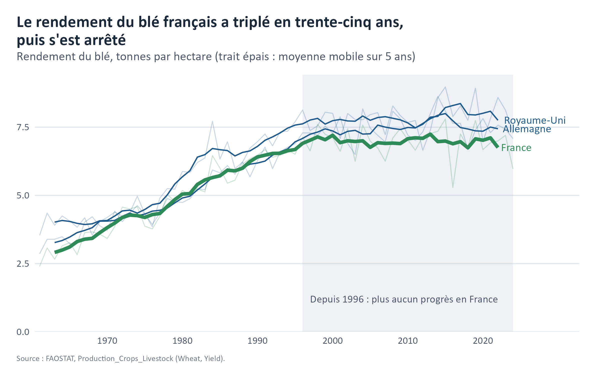
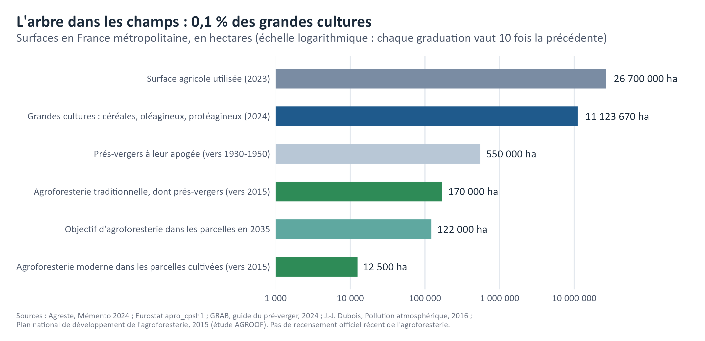
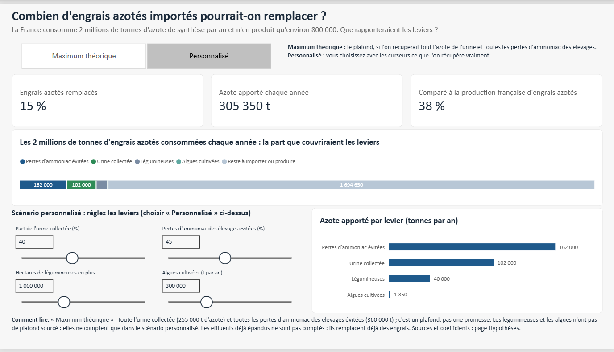
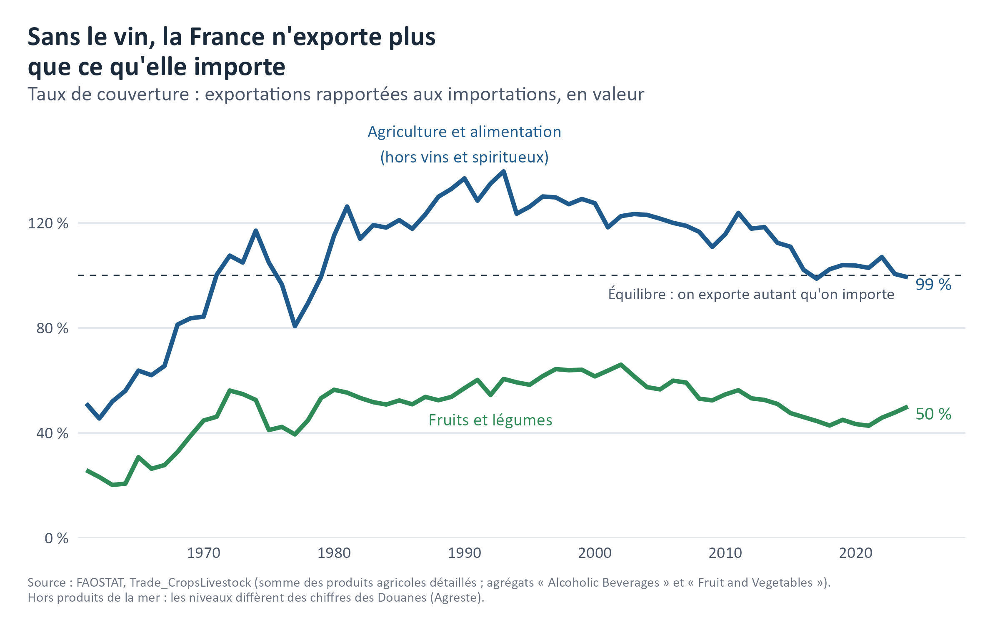
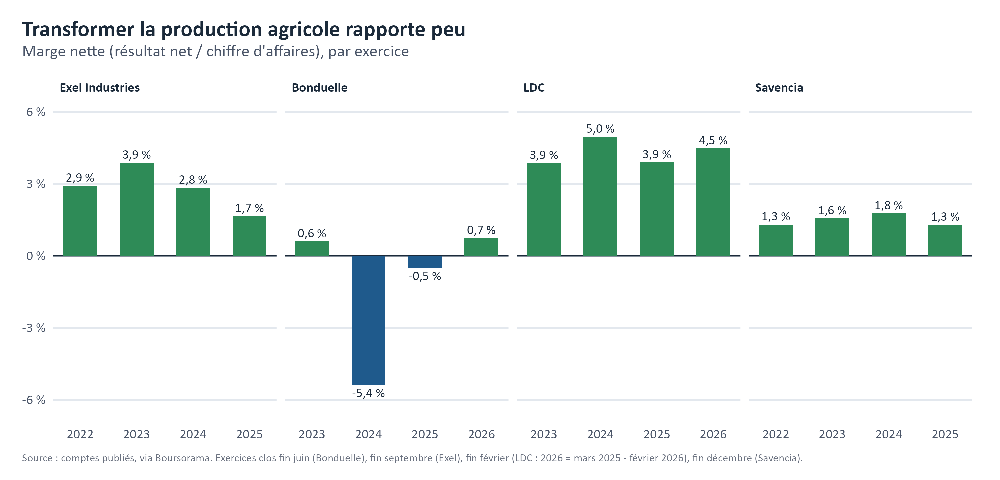

# La France et la terre : l'agriculture 2.0, mêler au lieu de séparer

Ce projet ne dresse pas l'inventaire d'un déclin : il chiffre une autre façon de produire. Le rendement du blé ne progresse
plus depuis trente ans, et la France importe l'essentiel de ses engrais. Intensifier davantage la monoculture, c'est importer
davantage. La thèse du projet est qu'il faut **mêler à nouveau ce que l'agriculture moderne a séparé** : l'arbre et la
culture, la culture et l'animal, le champ et l'eau. C'est ce qu'il appelle l'agriculture 2.0 : l'agroforesterie et la
complantation. Il mesure ce qu'elles rapportent, montre comment la politique agricole les a fait reculer en ne payant que
l'hectare nu, puis fait le tour des systèmes qui, de la Campanie au Sahel et du Japon au Brésil, mêlent encore les espèces
sur le même hectare. Il fait enfin l'inventaire de ce qui subsiste en France, et en particulier des systèmes qui relient
la terre à l'eau et à la mer : étangs de la Dombes, riz de Camargue, prés-salés, goémon, claires à huîtres. La récupération
de l'azote n'est traitée qu'en complément.

## 1. Le constat, en deux chiffres

**Le rendement plafonne.** Le blé français a gagné 0,12 t/ha chaque année entre le début des années 1960 et le milieu des
années 1990, passant de 2,9 à 6,6 t/ha. Depuis, il ne progresse plus : 6,8 t/ha en moyenne sur 2020-2024, soit 0,004 t/ha
de gain par an (FAOSTAT). On ne produira plus davantage en intensifiant la même technique.



**Les engrais viennent d'ailleurs.** Au début des années 1960, la France produisait 120 % de l'azote et 193 % de la potasse
qu'épandaient ses agriculteurs. Aujourd'hui, elle ne produit plus que 9 % du phosphate et aucune potasse ; pour l'azote,
la part produite en France est de 18 % selon FAOSTAT et d'environ 35 % selon FranceAgriMer (800 000 t produites pour
2 millions de tonnes consommées). Dans les deux cas, l'essentiel est importé : tout gain de rendement obtenu par les engrais
est un gain importé.


## 2. Ce que l'on a séparé

Pendant des siècles, l'agriculture française a associé sur la même parcelle des arbres, des cultures et des animaux : vignes
grimpant aux arbres fruitiers, vaches sous les pommiers, haies autour des champs. La mécanisation, le remembrement et la
spécialisation ont tout séparé : d'un côté la forêt, de l'autre le champ d'une seule espèce.

**Les surfaces.** Les grandes cultures (céréales, oléagineux, protéagineux) couvrent 11,1 millions d'hectares.
L'agroforesterie moderne, avec des arbres plantés dans des parcelles cultivées, ne dépassait pas 1 000 hectares en 2006
(Dupraz, cité par Agra Valor) et n'en couvrait que 10 000 à 15 000 vers 2015, soit **0,1 %** des grandes cultures. En
comptant les systèmes traditionnels (prés-vergers, alignements), on atteint environ 170 000 hectares (J.-J. Dubois, 2016).
Aucun recensement officiel récent ne mesure l'agroforesterie : c'est déjà un symptôme.



**Le recul.** Les prés-vergers, ces pommiers haute-tige sous lesquels pâturent les vaches, couvraient 500 000 à 600 000
hectares vers 1930-1950. Il en reste environ 100 000 à 165 000 selon les sources (GRAB, 2024 ; plan national de 2015), et
prés-vergers et bosquets reculaient encore de 21 000 hectares par an entre 2012 et 2014 (Solagro). Les haies sont passées de
1 244 000 km en 1975 à 708 000 km en 1987 (Pointereau, 2002) : 43 % en douze ans, au plus fort du remembrement. Elles ont
perdu 70 % de leur longueur depuis 1950 (annexe).

## 3. Pourquoi l'arbre a quitté les champs : la PAC payait l'hectare nu

L'arbre n'a pas reculé parce qu'il produisait moins. Il a reculé parce que les règles publiques, pendant un demi-siècle, ont
payé la parcelle d'une seule culture et compté l'arbre comme une surface perdue.

**1953 : on paie pour arracher.** La politique d'arrachage des pommiers de 1953, puis l'abandon des quotas d'État dans les
années 1970, ont poussé les producteurs normands à remplacer les pommiers haute-tige des prés-vergers par des vergers
basse-tige (CESER Normandie, 2024). Le remembrement des années 1955-1975 a fait le reste : les travaux qui l'accompagnaient
rasaient haies et arbres isolés pour agrandir les parcelles.

**1992 : l'aide à l'hectare de grande culture.** La réforme de la PAC de 1992 remplace le soutien des prix par des
« paiements compensatoires » versés à l'hectare de céréales, d'oléagineux et de protéagineux (règlement 1765/92). Ces paiements
sont refusés aux terres qui étaient, au 31 décembre 1991, en prairie permanente, en cultures permanentes ou en forêt (réponse
ministérielle au Sénat, 1999). Le système récompense donc exactement ce que l'agroforesterie défait : une seule culture
annuelle, sur une surface sans arbre. Une parcelle plantée d'arbres était, au mieux, une surface dont on déduisait les arbres.

**2006 : l'arbre toléré, puis déduit.** Il faut attendre un arrêté du 31 octobre 2006 pour que l'admissibilité des parcelles
agroforestières soit fixée : en dessous de 50 arbres par hectare, la parcelle reste aidée sur toute sa surface ; au-delà, la
surface occupée par les arbres est déduite (réponse ministérielle à l'Assemblée nationale). Un agriculteur qui plantait
perdait donc l'aide sur l'emprise de ses arbres, pour un bois qui ne rapporterait qu'au bout de vingt à cinquante ans. Le
seuil est passé à 100 arbres par hectare (guide d'admissibilité PAC 2024).

**2015 : le début d'un retournement.** L'agroforesterie est reconnue comme surface d'intérêt écologique, des aides à la
plantation apparaissent, et le plan national de développement de l'agroforesterie vise 122 000 hectares en 2035, dix fois la
surface de 2015. Mais le retard d'un demi-siècle ne se rattrape pas vite : un arbre planté en 2015 donne son bois vers 2050.

## 4. Le gain : produire plus sur le même hectare

**Le principe.** L'arbre et la culture n'exploitent pas les mêmes ressources au même endroit ni au même moment. Comme
l'explique Christian Dupraz, la céréale d'hiver assèche le sol de surface au printemps, ce qui oblige l'arbre à s'enraciner
plus profond, sous la culture. Sur 40 ans, d'après les simulations de l'INRAE, une parcelle de noyers et de blé intercepte
1,39 fois la lumière et valorise 1,55 fois l'eau d'une parcelle spécialisée.

**Le gain mesuré.** L'indicateur est la surface équivalente (*land equivalent ratio*, LER) : la surface qu'il faudrait,
arbres et cultures séparés, pour produire autant que l'hectare associé. Sur les parcelles de l'INRAE dirigées par Christian
Dupraz, il atteint **1,34 mesuré** (peupliers et céréales récoltés après 13 à 15 ans, Vézénobres, Gard) et **1,4 à 1,6
simulé** sur une rotation complète de noyers et de blé (Restinclières, Hérault). Cent hectares en agroforesterie produisent
autant de grain et de bois que 130 à 160 hectares séparés.


**Les paramètres techniques.** Les parcelles de l'INRAE comptent 80 noyers par hectare (Restinclières) ou 140 peupliers par
hectare, contre 200 en peupleraie pure (Vézénobres). Les rangées sont espacées pour laisser passer les machines : c'est ce qui
distingue l'agroforesterie moderne des systèmes anciens, abandonnés faute de pouvoir y faire passer un tracteur.

**La densité décide de tout.** En Chine, sur la plaine du fleuve Jaune, le blé est cultivé entre des rangées de paulownias.
Une étude de 1997 y trouve que le rendement du blé augmente tant que les arbres couvrent moins de 28 % de la parcelle, avec
un optimum vers 14 %, et baisse au-delà ; dans une parcelle plus dense, une étude de 2008 mesure un blé 51 % moins productif
qu'en plein champ. L'association n'est pas gagnante d'office : elle se règle, comme une dose d'engrais.

**Le filet de sécurité.** Les racines des arbres descendent sous la zone exploitée par la culture et y interceptent les
nitrates qui, sinon, gagneraient la nappe. L'INRAE modélise cet effet (projet METAGROFORESTRY) ; aucune mesure publique n'en
donne encore l'ampleur à l'échelle d'une parcelle française.

## 5. Ce qui subsiste en France, de la terre à la mer

La France n'a pas tout perdu. Il lui reste des systèmes qui mêlent les espèces, et une partie d'entre eux relient
précisément la terre et l'eau, jusqu'à la mer : c'est le lien entre ce projet et le précédent.

### À terre : l'arbre et la culture

**La joualle du Sud-Ouest : trois étages sur la même parcelle.** La joualle associe sur la même parcelle « de la vigne
poussant sur des arbres fruitiers et plusieurs autres cultures intercalaires ». Ses trois étages :
- **les arbres**, choisis selon le sol et le climat et renouvelés rang par rang : pêchers de vigne dans les Charentes,
  cerisiers en Gironde, pruniers d'Ente en Lot-et-Garonne et en Périgord, abricotiers sur les coteaux du Lot et de la
  Garonne ;
- **la vigne**, qui grimpe dans ces arbres utilisés comme « tuteurs vivants » ;
- **entre les rangs**, des bandes larges au moins du passage d'un attelage de bœufs, et parfois de 15 mètres, semées de
  légumes, de céréales (avoine, blé, orge, sarrasin), de fourrage, de betteraves, puis de pommes de terre ou de tabac.

Le même hectare donnait du vin, des fruits, du grain et du fourrage pour les bêtes de trait. La joualle était conçue pour
l'outil de son temps, l'attelage, comme l'agroforesterie de l'INRAE l'est pour le tracteur.

**Un système de deux mille ans.** Virgile, dans les *Géorgiques*, conseille déjà de « marier la vigne à l'ormeau ». La
joualle était si répandue que la « joualée de vigne » devient une mesure de surface dès 1340. Elle a reculé en trois
temps. Au XVIIIe siècle, l'abbé Rozier, agronome, la condamne : « Tout arbre nuit à la vigne, autant par son ombrage que
par ses racines. » En 1851, l'oïdium, apparu à Cartelègue dans le Blayais, « sonne le glas » des joualles du Bordelais ;
elles se maintiennent plus au nord, dans les Charentes. Au XXe siècle, la joualle se réduit à une alternance de rangs de
vigne et de bandes de blé jusqu'aux années 1960, puis le remembrement fait disparaître « la quasi-totalité des dernières
joualles ». Elle survit hors de France, en Galice et surtout dans le Minho portugais, la région du *vinho verde*.

Ce déclin résume tout le projet : une condamnation savante (l'arbre « nuit »), un choc sanitaire, puis la machine et la
réglementation. Les mesures de l'INRAE donnent aujourd'hui tort à l'abbé Rozier : quand la densité est réglée, l'arbre ne
retire pas à la culture plus qu'il n'ajoute par sa propre production.

Plus haut, dans le Comminges et le Béarn, les **hautains** faisaient monter la vigne sur des arbres vivants, au-dessus des
cultures : c'est la même famille que la *vite maritata* italienne décrite plus loin.

**Les prés-vergers.** En Normandie, le même pré donne des pommes à cidre, de l'herbe et du lait : les vaches pâturent sous
des pommiers haute-tige plantés à moins de 100 arbres par hectare, contre jusqu'à 3 000 dans un verger moderne (GRAB). Ce
système a reculé de 500 000 à environ 100 000 hectares en moins d'un siècle. L'Allemagne en a conservé davantage : ses
*Streuobstwiesen* couvrent encore 300 000 à 400 000 hectares selon les estimations.

### Au bord de l'eau douce : le champ et l'étang

**Les étangs de la Dombes (Ain) : la rizière à poissons française.** Depuis le Moyen Âge, les étangs de la Dombes alternent
deux années d'« évolage », en eau, où l'on élève carpes, tanches et brochets, et une année d'« assec », vidés et semés
d'avoine ou de maïs. Le poisson fertilise le fond de l'étang, la céréale en profite, puis l'eau revient sur un sol nettoyé.
C'est l'équivalent exact de la rizière à poissons chinoise, en rotation plutôt qu'en même temps. Il reste environ 1 100 à
1 200 étangs sur 11 200 hectares, contre près de 20 000 hectares au milieu du XIXe siècle (APPED ; ministère de la Culture).

**La Camargue : le riz qui dessale la terre.** Dans le delta du Rhône, le riz n'est pas qu'une culture : l'eau douce qui
l'inonde lessive le sel qui remonte de la mer et rend la terre cultivable pour les années suivantes. Il tourne avec le blé
dur et la luzerne, et les fermes y associent souvent un élevage de taureaux ou de moutons dont le fumier revient aux
champs ; en agriculture biologique, une année de riz alterne avec au moins quatre de cultures sèches (INRAE). La surface en
riz est passée d'environ 32 000 hectares en 1962 à moins de 5 000 en 1981, remontée à 21 000 en 2012, puis retombée à
environ 11 500 (FranceAgriMer, 2024).

**Le Marais poitevin : la prairie sous les arbres têtards.** Entre Niort et la mer, le « marais mouillé » est un bocage
d'eau : prairies pâturées ou fauchées, bordées de canaux et de frênes taillés en têtard, dont on récoltait les branches pour
le bois et le fourrage. Il en reste près de 400 000. L'inventaire de 2001 estimait qu'il manquait déjà près des trois quarts
des arbres plantés à l'origine ; la chalarose, une maladie du frêne, les décime aujourd'hui, et 17 000 arbres ont été
replantés depuis 2017 (parc naturel régional ; Natura 2000).

### Au contact de la mer : ce que la mer donne à la terre

**Les prés-salés.** Dans la baie du Mont-Saint-Michel et celle de la Somme, des moutons pâturent les herbus que la marée
recouvre : l'herbe salée, nourrie par les sédiments de la mer, devient de la viande, sans engrais ni culture. Les deux baies
ont chacune leur appellation d'origine protégée. La baie du Mont-Saint-Michel produit 8 000 à 10 000 agneaux par an, dont
environ 1 500 sous appellation (*Réussir*, 2024).

**Le goémon et la ceinture dorée.** Sur la côte du Léon, autour de Roscoff et de Saint-Pol-de-Léon, les paysans ont
fertilisé pendant des siècles leurs champs avec le goémon ramassé sur les grèves et avec le maërl, un sable calcaire
d'algues. Ce sont ces terres, enrichies par la mer, qui ont fait vers 1880 la « ceinture dorée » des légumes bretons
(artichauts, choux-fleurs, oignons). L'épandage d'algues y est devenu minoritaire, mais la ressource reste : Lanildut, premier
port goémonier d'Europe, débarque environ 35 000 tonnes d'algues par an, aujourd'hui surtout pour l'industrie.

**Les claires de Marennes-Oléron : la saline devenue parc à huîtres.** Quand le sel de l'Atlantique a cessé de payer, les
ostréiculteurs charentais ont repris les marais salants abandonnés et en ont fait des « claires », bassins d'argile où les
huîtres sont affinées. Environ 3 000 hectares de claires produisent une huître sous indication géographique protégée,
environ 17 000 tonnes par an. C'est un recyclage d'infrastructure : un ouvrage de la terre conçu pour la mer, réemployé
pour un autre usage de la mer.

| Système | Région | Ce qui est mêlé | Surface ou volume | Tendance |
|---|---|---|---|---|
| Prés-vergers | Normandie, Bretagne | pommiers + herbe + vaches | 100 000 à 165 000 ha | en recul |
| Joualles et hautains | Sud-Ouest, Pyrénées | vigne + fruitiers + céréales | non chiffré | quasi disparus |
| Étangs de la Dombes | Ain | poissons puis céréales | 11 200 ha, 1 100 à 1 200 étangs | 20 000 ha vers 1850 |
| Riz de Camargue | Bouches-du-Rhône, Gard | riz + blé dur + luzerne + taureaux | environ 11 500 ha | moitié de 2012 |
| Marais poitevin | Vendée, Deux-Sèvres, Charente-Maritime | frênes têtards + prairies + bétail | près de 400 000 têtards | chalarose |
| Prés-salés | Mont-Saint-Michel, Somme | herbus marins + moutons | 8 000 à 10 000 agneaux/an | stable, deux AOP |
| Goémon et ceinture dorée | Léon | algues et maërl + légumes | 35 000 t d'algues à Lanildut | épandage minoritaire |
| Claires | Marennes-Oléron | anciens marais salants + huîtres | 3 000 ha, 17 000 t/an | menacées par la chaleur l'été |

## 6. Ailleurs : onze systèmes qui mêlent

L'agriculture 2.0 n'invente rien : elle redécouvre des systèmes qui ont fait leurs preuves, et les mesure. En voici onze,
classés par continent.

**En Europe.**
- **L'alberata aversana (Campanie).** Entre Naples et Caserte, la vigne d'asprinio est « mariée » à des peupliers et monte
  à 7 à 15 mètres ; on la vendange sur de hautes échelles, et le sol reste libre pour d'autres cultures. C'est la *vite
  maritata* des Étrusques. Elle couvrait plus de 16 000 hectares en 1960 ; il en reste quelques centaines (Italia Nostra),
  aujourd'hui protégées par un présidium Slow Food.
- **La dehesa et le montado (Espagne, Portugal).** Environ 3,5 millions d'hectares de prairies plantées de chênes donnent
  sur le même sol de l'herbe, du liège, du bois et des glands, que les porcs ibériques viennent manger à l'automne ; leurs
  déjections fertilisent la prairie. Le décret de 2014 sur le porc « de bellota » impose au moins 46 kg pris à la glandée, en
  plus de 60 jours, et 0,25 à 1,25 porc par hectare au plus selon la couverture des arbres. Environ 700 000 porcs étaient
  certifiés par saison au milieu des années 2010.

**En Afrique.**
- **L'arbre qui perd ses feuilles à la saison des pluies (Malawi, Zambie).** *Faidherbia albida* fait l'inverse des autres
  arbres : il perd ses feuilles quand commence la saison des pluies et ne fait donc pas d'ombre au maïs pendant sa
  croissance, puis il enrichit le sol en azote et en matière organique par ses feuilles tombées. En Zambie, la FAO relève
  4,7 t/ha de maïs sous les arbres contre 1,9 t/ha hors de leur couvert. Les services agricoles du Malawi et de la Zambie
  recommandent une centaine d'arbres par hectare.
- **La régénération naturelle au Niger.** Plutôt que de planter, les paysans du sud du Niger laissent repousser et taillent
  les souches d'arbres qui subsistent dans leurs champs. La pratique s'est étendue à environ 5 millions d'hectares et
  quelque 200 millions d'arbres (partenariat des Nations unies). Les mesures locales montrent des rendements de mil plus
  élevés près des arbres.
- **L'oasis à trois étages (Maghreb).** En haut le palmier dattier, qui fait de l'ombre et coupe le vent ; au milieu les
  fruitiers (abricotier, grenadier, figuier, olivier) ; au sol le fourrage, les légumes et les céréales. Les oasis de palmiers
  couvrent environ 500 000 hectares dans la région et font vivre plus de cinq millions de personnes (CIRAD). Leur menace est
  précisément la conversion en monoculture de palmiers.

**En Asie.**
- **La rizière à poissons (Qingtian, Chine).** On y élève des carpes dans les rizières depuis plus de mille ans : les
  poissons mangent les insectes et les mauvaises herbes, et fertilisent l'eau. C'est l'un des premiers systèmes reconnus en
  2005 par la FAO comme « patrimoine agricole mondial », qui souligne la baisse des pesticides et des engrais.
- **La rizière à canards (Japon).** La méthode *aigamo*, popularisée par Takao Furuno : des canetons de sept jours sont lâchés
  dans la rizière, à raison de 15 à 30 pour 1 000 m², et retirés au bout de huit semaines. Ils mangent les mauvaises herbes
  et les insectes, et leurs fientes fertilisent. Environ 10 000 agriculteurs japonais l'appliquent ; Furuno vend riz, canards,
  œufs et légumes sur 3,2 hectares.
- **Le blé sous les paulownias (Chine).** Cité plus haut : un système répandu sur la plaine du fleuve Jaune, qui montre que
  le gain dépend de la densité des arbres.
- **Le jardin-forêt kandyen (Sri Lanka).** Sur des parcelles de 0,4 hectare en moyenne, plusieurs étages se superposent :
  arbres à bois, fruitiers (jacquier, manguier), plantes d'exportation (poivre, girofle, café), plantes médicinales. Une
  étude y compte, par hectare, 73 arbres à bois, 193 fruitiers, 300 plantes médicinales et 147 plantes d'exportation.
  Le système est pratiqué depuis plusieurs siècles.

**En Amérique.**
- **La cabruca (Bahia, Brésil).** Le cacao pousse sous les grands arbres de la forêt atlantique, dont on n'a éclairci que
  le sous-bois : 35 à 355 arbres d'ombrage par hectare selon les parcelles. Environ 70 % des quelque 650 000 hectares de
  cacao de Bahia seraient conduits ainsi, et la loi de l'État impose depuis 2014 d'y garder au moins 20 arbres natifs par
  hectare.
- **Le pâturage arboré intensif (Colombie, Mexique).** Les vaches pâturent entre des rangs serrés de *Leucaena*, un arbuste
  fourrager qui fixe l'azote de l'air, planté à plus de 10 000 pieds par hectare sous des arbres à bois. Les comparaisons
  publiées trouvent 1,5 à 5 fois plus de lait par hectare et par jour que dans les prairies classiques (Murgueitio et al.,
  2011).

| Système | Pays | Ce qui est mêlé | Surface | Gain ou fait chiffré |
|---|---|---|---|---|
| Agroforesterie INRAE | France | noyers ou peupliers + céréales | quelques dizaines d'ha d'essais | LER 1,34 mesuré, 1,4 à 1,6 simulé |
| Prés-vergers | France, Allemagne | pommiers + herbe + vaches | 100 000 ha (FR), 300 000 à 400 000 ha (DE) | moins de 100 arbres/ha |
| Alberata aversana | Italie | vigne + peupliers + cultures | 16 000 ha en 1960, quelques centaines aujourd'hui | vigne de 7 à 15 m |
| Dehesa | Espagne, Portugal | chênes + herbe + porcs | environ 3,5 millions d'ha | 0,25 à 1,25 porc/ha |
| *Faidherbia albida* | Zambie, Malawi | arbre + maïs | — | 4,7 contre 1,9 t/ha de maïs |
| Régénération naturelle | Niger | arbres + mil | environ 5 millions d'ha | 200 millions d'arbres |
| Oasis à trois étages | Maghreb | palmier + fruitiers + cultures | environ 500 000 ha | 5 millions d'habitants |
| Rizière à poissons | Chine | riz + carpes | — | patrimoine agricole mondial (FAO, 2005) |
| Rizière à canards | Japon | riz + canards | environ 10 000 fermes | 15 à 30 canetons pour 1 000 m² |
| Blé sous paulownias | Chine | paulownias + blé | — | gain si arbres sous 28 % de couverture |
| Jardin kandyen | Sri Lanka | 4 étages d'arbres et de plantes | parcelles de 0,4 ha | plus de 700 plantes utiles/ha |
| Cabruca | Brésil | cacao + arbres de forêt | environ 450 000 ha | 35 à 355 arbres/ha |
| Pâturage arboré intensif | Colombie, Mexique | *Leucaena* + herbe + vaches | — | 1,5 à 5 fois plus de lait/ha |

## 7. Ce que ces systèmes enseignent

**Ils produisent plusieurs choses sur le même hectare** (grain, bois, fruits, lait, viande), et c'est ce total, non le
rendement d'une seule culture, qui compte. **Ils recyclent sur place ce que la monoculture achète** : l'azote (fientes,
déjections, arbres et arbustes fixateurs), le désherbage (canards, poissons, porcs), la protection contre le vent et la
chaleur (palmier, paulownia). **Ils se règlent** : densité d'arbres, nombre de porcs ou de canetons par hectare ; trop
d'arbres, et le blé baisse. **Ils ont reculé pour des raisons qui ne tiennent pas à leur productivité** : ils se prêtaient
mal à la machine, et la politique agricole payait l'hectare d'une seule culture.

Ce que la recherche apporte, c'est de les rendre compatibles avec la machine : des rangées d'arbres espacées pour le passage
des engins, des essences choisies pour la valeur de leur bois, des densités mesurées. Ce qui manque en France, c'est
l'échelle : 10 000 à 15 000 hectares pour 11 millions d'hectares de grandes cultures.

**Le lien avec la mer.** Les systèmes français qui ont le mieux résisté sont ceux qui vivent au contact de l'eau : la
Dombes, la Camargue, le Marais poitevin, les prés-salés, les claires. Là, l'eau imposait de mêler, et la machine ne pouvait
pas tout séparer. Ils montrent ce que le projet précédent sur la mer laissait entrevoir : la terre et la mer ne sont pas
deux économies distinctes. La mer nourrit l'herbe des prés-salés et les champs du Léon ; la terre, par ses fleuves, nourrit
les huîtres des claires. Les séparer, c'est perdre dans les deux sens.

## 8. En complément : ne plus perdre l'azote que l'on épand

L'agriculture 2.0 réduit le besoin d'engrais ; elle ne le supprime pas. L'autre moitié du sujet est de ne plus perdre ce que
l'on épand.

**L'excès est mesuré.** En 2020, 4,2 millions de tonnes d'azote ont été apportées aux terres agricoles françaises : pour
moitié des engrais minéraux, pour 40 % des déjections animales, le reste venant des légumineuses et de l'air. Les cultures
et les prairies n'en ont prélevé que 2,7 millions, soit 64 %. 540 000 tonnes se sont volatilisées, surtout sous forme
d'ammoniac, et 970 000 tonnes sont restées en excédent dans les sols (INSEE, 2024). L'azote n'est pas nocif pour les
cultures, c'est l'élément dont elles ont le plus besoin ; ce qui coûte, c'est l'excès, que la plante ne prend pas et qui part
vers les nappes, les fleuves et l'air.


**Les leviers, du plus gros au plus petit.**
- **Les pertes d'ammoniac des élevages** : environ 360 000 tonnes d'azote par an, les deux tiers des pertes dans l'air
  (INSEE). Injecter le lisier dans le sol ou l'enfouir vite réduit ces pertes de 70 à 90 % (chambres d'agriculture, d'après
  l'ADEME). C'est aussi une question d'agriculture mêlée : entre 2010 et 2020, la France a perdu 30 % de ses fermes de
  polyculture-élevage, celles qui épandaient sur leurs champs le fumier de leurs bêtes.
- **Les légumineuses** (pois, féverole, luzerne, trèfle) fixent l'azote de l'air : un blé semé après un pois demande 20 à
  60 kg d'azote de moins par hectare (DRAAF Grand Est, d'après Terres Inovia).
- **L'urine** : 85 % de l'azote de nos excréments s'y trouve, et les stations d'épuration le renvoient dans l'air. Sur environ
  300 000 tonnes excrétées, 10 % seulement reviennent aux cultures (Starck, Fardet et Esculier, LEESU, 2023). Collectée à
  part, elle remplacerait environ 15 % des engrais azotés de synthèse. Victor Hugo l'écrivait en 1862 : « Si notre or est
  fumier, en revanche, notre fumier est or. »
- **Le pilotage de la dose** : dans neuf essais en Centre-Val de Loire, la méthode APPI-N de l'INRAE et d'Arvalis a réduit
  la dose de 33 kg d'azote par hectare sans perte significative de rendement.
- **Les cultures intermédiaires** entre deux récoltes réduisent de plus de moitié le nitrate des eaux de drainage (INRA, 2012).
- **La mer cultivée** (algues, moules) rend un peu d'azote aux champs, mais elle en retire environ 1 000 tonnes, contre
  607 000 tonnes apportées chaque année par les fleuves (SDES) : un complément, pas une solution.

Le détail de ces chiffres (boues d'épuration par pays, devenir de l'azote des excréments, ordres de grandeur marins) figure en
annexe.

## 9. Ce que cela donne ensemble

| Levier | Gain chiffré | Délai | Limite principale |
|---|---|---|---|
| Agroforesterie | 1,3 à 1,6 fois la production d'un hectare spécialisé | 15 à 50 ans pour le bois | peu de mesures en vraie grandeur ; densité à régler |
| Complantation et pâturage arboré | jusqu'à 1,5 à 5 fois plus de lait/ha (Colombie) ; maïs 4,7 contre 1,9 t/ha (Zambie) | quelques années | résultats obtenus sous d'autres climats |
| Prés-vergers | herbe, lait et fruits sur le même hectare | plusieurs années | passage des machines, marché du cidre |
| Pertes d'ammoniac des élevages | jusqu'à 360 000 t d'azote par an ; 70 à 90 % évitables à l'épandage | immédiat | matériel, coût, distance élevages-cultures |
| Légumineuses | 20 à 60 kg d'azote en moins par hectare sur le blé suivant | une rotation | débouchés et rendements à sécuriser |
| Séparation de l'urine | jusqu'à 15 % des engrais azotés de synthèse | dès les constructions neuves | réseaux à créer, collecte |

La mer, le fleuve, puis la terre : dans chaque domaine, le savoir existe et il est souvent français, qu'il s'agisse de GTT
pour les cuves des méthaniers ou de l'INRAE pour l'agroforesterie. Ce qui manque n'est pas la technique, mais sa mise en
œuvre. Ce sera l'objet du projet suivant.

## Simulateur Power BI

Le simulateur porte sur le complément de la section 8, le seul volet du projet qui se prête à une addition de tonnes.
Le dossier `powerbi/` contient un simulateur interactif (format PBIP, à ouvrir avec Power BI Desktop) qui pose une seule
question : **combien d'engrais azotés importés pourrait-on remplacer ?** Une grande jauge représente les 2 millions de tonnes
d'azote de synthèse consommées chaque année, remplies levier par levier ; trois chiffres donnent l'azote apporté, la part des
engrais remplacée et la comparaison avec la production française (800 000 t).


Deux scénarios. **« Maximum théorique »** : toute l'urine collectée (255 000 t d'azote) et toutes les pertes d'ammoniac des
élevages évitées (360 000 t), soit 615 000 t, 31 % des engrais azotés consommés et 77 % de la production française. C'est un
plafond, pas une promesse. **« Personnalisé »** : quatre curseurs règlent la part de l'urine collectée, la part des pertes
d'ammoniac évitées, les hectares de légumineuses en plus et les tonnes d'algues cultivées. Les légumineuses et les algues
n'entrent pas dans le maximum, faute de plafond sourcé. Une page compare les pays européens sur leurs boues d'épuration, une
autre liste chaque coefficient avec sa source. Exemple de scénario personnalisé ci-dessous : 40 % de l'urine collectée,
45 % des pertes d'ammoniac évitées, un million d'hectares de légumineuses en plus et 300 000 tonnes d'algues apportent
305 350 tonnes d'azote, soit 15 % des engrais azotés consommés.



Côté technique : chaque curseur est un paramètre de simulation (`GENERATESERIES`, `SELECTEDVALUE` avec valeur par défaut) ;
les coefficients sont des mesures constantes regroupées dans un dossier « Hypothèses », si bien qu'une hypothèse se change à
un seul endroit ; les pourcentages sont stockés en entiers (0 à 100) pour que le filtre d'un curseur retrouve toujours sa
valeur exacte ; les cartes affichent un texte déjà formaté (« 615 000 t ») plutôt que les abréviations par défaut. Les
calculs sont vérifiés par requêtes DAX sur le modèle.

## Limites

- **Le plateau du blé a plusieurs causes** (choix variétaux, réduction des intrants, aléas de récolte) ; ce projet le
  constate, il ne les départage pas.
- **Le LER mesuré l'a été sur peu de parcelles** : 1,34 provient d'un essai de peupliers ; 1,4 à 1,6 sont simulés.
- **L'usage agricole d'engrais publié par la FAO est irrégulier entre 2003 et 2014** ; seules les périodes 1961-1965 et
  2020-2024 sont comparées.
- **Le bilan de l'azote des excréments** porte sur 2015-2020, avec une part recyclée estimée entre 5 et 15 %. Le chiffre
  parfois cité d'un recyclage de 50 % de l'azote parisien vers 1904 n'a pas pu être vérifié à la source ; il n'est pas repris.
- **Les champs d'épandage ont laissé des sols pollués** au plomb, parce que les eaux mêlaient rejets domestiques et
  industriels (suivi de l'ARS Île-de-France). La séparation à la source répond aussi à ce problème.
- **Les coefficients marins sont des ordres de grandeur.** 13,7 kg d'azote par tonne vient de moules danoises dites « de
  compensation », récoltées jeunes ; les moules de bouchot françaises peuvent s'en écarter. 4,5 kg par tonne d'algues vient
  de deux essais danois de laminaire sucrée cultivée (environ 23 g d'azote pour 5,1 kg de biomasse par mètre de filière ;
  5 à 7 g pour 1,1 à 1,5 kg dans un essai antérieur), connus par leurs résumés, et appliqué ici aux laminaires sauvages.
- **Le bilan de l'azote des excréments est une prépublication** (arXiv, 2023), sans publication connue dans une revue à
  comité de lecture ; ses auteurs (LEESU, École des Ponts) sont toutefois les spécialistes français du sujet. Le flux des fleuves est une moyenne
  décennale publiée par le SDES. L'effet des huîtres n'est pas compté.
- **La dehesa est mal mesurée** : sa surface varie de 0,5 à plus de 3,5 millions d'hectares selon la définition ; le chiffre
  de 700 000 porcs date d'une saison du milieu des années 2010.
- **Production française d'engrais azotés : deux sources discordantes.** FAOSTAT donne 343 000 t (moyenne 2020-2024),
  FranceAgriMer 800 000 t (2025) ; la série FAO présente une rupture vers 2012. Le graphique des engrais repose sur FAOSTAT ;
  la potasse (0 %) et le phosphate (9 %) ne sont pas en cause.
- **Les leviers ne s'additionnent pas.** Effluents, urine, légumineuses et cultures intermédiaires portent sur des flux
  d'azote qui se recouvrent en partie ; leurs gains ne peuvent pas être sommés.
- **Les effluents déjà épandus ne sont pas comptés comme un levier** : ils remplacent déjà des engrais. Seules leurs
  pertes d'ammoniac le sont (environ 360 000 t, deux tiers des 540 000 t volatilisées selon l'INSEE). Les taux de réduction
  par injection ou enfouissement (70 à 90 %) viennent de fiches de chambres d'agriculture reprenant l'ADEME.
- **Deux mesures des déjections animales.** L'INSEE compte 1,68 million de tonnes d'azote dans les déjections (y compris au
  pâturage) ; FranceAgriMer, 597 500 tonnes dans les seuls fumiers et lisiers collectés. Les deux chiffres ne mesurent pas
  la même chose.
- **Le gain de la méthode APPI-N** repose sur neuf essais régionaux (2017-2019) ; il n'est pas généralisable tel quel.
- **L'agroforesterie n'a pas de recensement officiel récent.** Les surfaces (10 000 à 15 000 ha d'agroforesterie moderne,
  170 000 ha de systèmes traditionnels) datent de 2015-2016 ; celles des prés-vergers varient de 100 000 à 165 000 ha selon
  les sources. Les grandes cultures ne sont pas toutes des monocultures au sens strict : elles tournent d'une année sur
  l'autre, mais chaque parcelle porte une seule espèce à la fois.
- **La complantation historique n'est pas chiffrée** : aucune statistique ne mesure l'étendue passée des joualles Leur
  histoire repose sur l'article Wikipédia, dont les notes sont incomplètes ; sa mention d'une survivance en Galice et
  dans le Minho n'a pas été vérifiée par ailleurs.
- **Les systèmes français au contact de l'eau sont chiffrés par des sources de filière.** Le nombre d'étangs de la Dombes
  varie de 1 100 à 1 200 selon les sources ; la surface en riz de Camargue varie fortement d'une année à l'autre ; aucune
  source trouvée ne donne la surface des herbus pâturés ni le tonnage d'algues épandu sur les champs du Léon ; le chiffre de
  3 000 hectares de claires désigne parfois les claires seules, parfois les claires et les parcs.
- **Les exemples étrangers n'ont pas tous la même solidité.** Les chiffres de *Faidherbia* (FAO), du Niger (Nations unies),
  de la rizière à canards (presse et fiches de vulgarisation) et de la cabruca (surface non datée) viennent de sources de
  programme plutôt que d'essais publiés ; le gain de rendement souvent prêté à la méthode *aigamo* (20 à 50 %) n'est pas
  repris, faute de données d'essai. Ces systèmes sont obtenus sous d'autres climats et ne se transposent pas tels quels.
- **Les surfaces des *Streuobstwiesen*** varient de 300 000 à 400 000 ha selon les estimations, et leur recul depuis 1950
  de 20 à 70 % selon la base retenue ; seule la surface est reprise.
- **L'histoire réglementaire de l'arbre agricole est reconstituée par morceaux** : le règlement de 1992 et l'arrêté de 2006
  sont connus par des réponses ministérielles, la politique d'arrachage de 1953 par une synthèse du CESER de Normandie ;
  le montant des primes et le nombre d'arbres arrachés n'ont pas été retrouvés. Entre 1992 et 2006, aucun texte consulté
  ne fixe la règle applicable aux parcelles arborées.

## Annexe : le contexte en graphiques

Ces graphiques complètent le constat sans en être le cœur.

- Exploitations : 1,59 million en 1970, 390 000 en 2020 ; entre 2010 et 2020, −30 % pour la polyculture-élevage contre −3 %
  pour les grandes cultures (Agreste).
- Balance agricole hors vins et spiritueux : taux de couverture de 140 % en 1993, 99 % en 2024 ; fruits et légumes, 50 %
  (FAOSTAT).
- Haies : 70 % disparues depuis 1950 ; perte nette de 23 571 km par an entre 2017 et 2021, pour 3 000 km plantés (CGAAER).
- Industriels de l'aval (Bonduelle, Exel Industries, LDC, Savencia) : marges nettes de −5 % à +5 % (comptes publiés).
- Boues d'épuration : la France en épand ou composte 88 %, contre 17 % en Allemagne et aucune aux Pays-Bas ni en Suisse
  (Eurostat, 2024). Les champs d'épandage parisiens couvraient plus de 5 000 hectares vers 1910 (Dufour).
- Azote des excréments : sur environ 300 000 t, 50 % partent dans l'air, 40 % dans l'eau ou les sols, 10 % reviennent aux
  cultures (LEESU, 2023).
- Mer cultivée : laminaires et moules récoltées retirent environ 1 000 t d'azote, contre 607 000 t apportées par les fleuves
  (SDES) ; une tonne de moules retire environ 13,7 kg d'azote, une tonne de laminaire environ 4,5 kg.
- Phosphore : la Suisse impose depuis 2026 de le récupérer dans les boues, l'Allemagne l'imposera en 2029.

| | |
|---|---|
|  |  |
|  |  |
|  |  |
|  |  |

## Reproduire

```
cd donnees && python extraire_fao.py && python extraire_eurostat.py && python extraire_boursorama.py && cd ..
Rscript analyse.R
```
Les scripts Python lisent les fichiers FAOSTAT (`donnees/brut/fao/`, non versionnés car volumineux), les fichiers JSON
Eurostat et les pages Boursorama enregistrés dans `donnees/brut/`. `analyse.R` écrit les graphiques et `resultats.txt`
dans `sorties/`. Packages R : dplyr, tidyr, ggplot2, scales. Le détail des sources figure dans `donnees/SOURCES.md`.

## Sources

- FAOSTAT : [production](https://www.fao.org/faostat/fr/#data/QCL), [échanges](https://www.fao.org/faostat/fr/#data/TCL),
  [engrais](https://www.fao.org/faostat/fr/#data/RFN).
- INRAE, [*Agroforesterie et agrivoltaïsme*](https://ciag.hub.inrae.fr/content/download/5447/41887?version=1) ;
  C. Dupraz, [texte du concours agro-véto 2023](https://www.concours-agro-veto.fr/sites/default/files/media/2025-10/sujet_paysage_2023.pdf) ;
  résultats de Restinclières et Vézénobres repris par la [Mission bocage](https://www.parc-loire-anjou-touraine.fr/sites/default/files/2020-04/journees-techniques-agroforesterie-definition-et-perspectives-mission-bocage.pdf) ;
  [METAGROFORESTRY](https://biosefair.hub.inrae.fr/media/files/fiche_resultats_metagroforestry).
- Joualles : [Wikipédia, « Joualle »](https://fr.wikipedia.org/wiki/Joualle) (d'après G. Lavignac, *Cépages du Sud-Ouest*, Éditions du Rouergue, 2001 ; abbé Rozier, *L'Art de faire du vin en Provence*, 1772) ; Virgile, [*Géorgiques*](https://fr.wikisource.org/wiki/G%C3%A9orgiques_I) ;
  [Les Vergers retrouvés du Comminges](https://www.les-vergers-retrouves-du-comminges.org/histoire/joualles-et-hautains/).
- Dehesa : [Real Decreto 4/2014](https://www.boe.es/buscar/act.php?id=BOE-A-2014-318) ;
  [Agronews Castilla y León](https://www.agronewscastillayleon.com/en-la-ultima-montanera-se-certificaron-703000-cochinos-ibericos-de-bellota), juillet 2017 ;
  surface : [Cuadernos Geográficos](https://revistaseug.ugr.es/index.php/cuadgeo/article/download/8641/9681).
- V. Hugo, *Les Misérables*, t. V, l. II, ch. 1, [« La terre appauvrie par la mer »](https://fr.wikisource.org/wiki/Les_Mis%C3%A9rables/Tome_5/Livre_2/01), 1862.
- É. Dufour, [*La persistance des champs d'épandage d'eaux usées de l'agglomération parisienne*](https://metropolitiques.eu/IMG/pdf/dufour.pdf), *Métropolitiques*.
- ARS Île-de-France, [*Les plaines d'épandage*](https://www.iledefrance.ars.sante.fr/les-plaines-depandage-controle-et-suivi-sanitaire-par-lagence).
- Eurostat : [env_ww_spd](https://ec.europa.eu/eurostat/databrowser/view/env_ww_spd/default/table) (boues),
  [fish_aq2a](https://ec.europa.eu/eurostat/databrowser/view/fish_aq2a/default/table) (aquaculture).
- T. Starck, T. Fardet, F. Esculier, [*Fate of nitrogen in French human excreta*](https://arxiv.org/abs/2310.06880), 2023.
- SDES, [flux d'azote des fleuves vers la mer](https://www.statistiques.developpement-durable.gouv.fr/flux-la-mer-trop-dazote-mais-moins-de-phosphore).
- D. Taylor, C. Saurel, P. Nielsen, J. K. Petersen, [*Production Characteristics and Optimization of Mitigation Mussel Culture*](https://www.frontiersin.org/articles/10.3389/fmars.2019.00698), *Frontiers in Marine Science*, 2019.
- Laminaire sucrée au Danemark : [*Commercial scale cultivation of Saccharina latissima in Denmark*](https://www.sciencedirect.com/science/article/pii/S2211926426002456) ;
  [*Commercial cultivation and bioremediation potential of sugar kelp in Danish waters*](https://link.springer.com/article/10.1007/s10811-014-0519-8), 2015 (résumés).
- Récolte de laminaires : [Institut Agro](https://halieutique.institut-agro.fr/files/fichiers/pdf/5897.pdf) ;
  [préfecture de Bretagne](https://www.prefectures-regions.gouv.fr/bretagne/irecontenu/telechargement/132451/972128/file/Note%20de%20pr%C3%A9sentation%20D%C3%A9lib%C3%A9ration%20ALGUES%20MESURES%20TECHNIQUES.pdf).
- FranceAgriMer, *Ressources en biomasse : quel potentiel de substitution des engrais de synthèse ?*, juin 2025, cité par
  [*Réussir*](https://www.reussir.fr/grandes-cultures/fertilisation-azotee-la-france-peut-elle-remplacer-les-engrais-mineraux-par-la-biomasse-organique), 9 juillet 2025.
- Légumineuses : DRAAF Grand Est, [*Fixer de l'azote par les légumineuses*](https://draaf.grand-est.agriculture.gouv.fr/IMG/pdf/gazote_2-202104-fixer_de_l_azote_par_les_legumineuses.pdf), 2021.
- INRA, [*Réduire les fuites de nitrate au moyen de cultures intermédiaires*](https://reseau-eau.educagri.fr/files/fichierRessource1_Etude_CIPAN-8pages_juin12.pdf), synthèse, juin 2012.
- Phosphore : OFEV (Suisse), [rapport explicatif sur l'ordonnance sur les déchets](https://www.bafu.admin.ch/dam/fr/sd-web/UP9nWLKjlIUr/Rapport%2Bexplicatif%2Bconcernant%2Bla%2Bmodification%2Bde%2Bl%E2%80%99ordonnance%2Bsur%2Bles%2Bd%C3%A9chets%2BOLED.pdf) ;
  [ville de Stuttgart](https://www.stuttgart.de/fr/pressemitteilungen/2024/maerz/gemeinsamer-schritt-zur-nachhaltigen-phosphorrueckgewinnung-aus-klaerschlammasche-im-suedwesten), mars 2024.
- INSEE, [*Évolution des surplus d'azote et de phosphore*](https://www.insee.fr/fr/statistiques/fichier/version-html/7728891/AGRI24-F27.pdf), fiche 4.7, *Transformations de l'agriculture et des consommations alimentaires*, édition 2024.
- Pilotage de l'azote : C. Baudart, [« De nouvelles méthodes pour piloter l'apport d'azote en temps réel »](https://www.reussir.fr/grandes-cultures/de-nouvelles-methodes-pour-piloter-lapport-dazote-en-temps-reel), *Réussir Grandes cultures*, 31 décembre 2019 (méthode APPI-N, INRAE et Arvalis).
- Surfaces de l'agroforesterie : J.-J. Dubois, [« L'évolution des systèmes agroforestiers en France »](https://www.peren-revues.fr/pollutionatmospherique/5700), *Pollution atmosphérique*, 2016 ;
  [Plan national de développement de l'agroforesterie](https://agriculture.gouv.fr/sites/default/files/151215-ae-agrofesterie-v2_plan.pdf), 2015 ;
  GRAB, [*Guide du pré-verger*](https://www.grab.fr/wp-content/uploads/2024/02/guide-pre-verger.pdf), 2024 ; Agreste, [Mémento 2024](https://agreste.agriculture.gouv.fr/agreste-web/download/publication/publie/MemSta2024/M%C3%A9mento%20France_2024.pdf).
- PAC : [guide d'admissibilité 2024](https://www.telepac.agriculture.gouv.fr/telepac/pdf/tas/2024/Dossier-PAC-2024_guide-admissibilite.pdf) (seuil de 100 arbres par hectare).
- Histoire réglementaire : CESER Normandie, [*Synthèse filière pomme à cidre*](https://www.ceser.normandie.fr/sites/default/files/2024-11/Synth%C3%A8se%20fili%C3%A8re%20pomme%20%C3%A0%20cidre.pdf), 2024 (arrachage de 1953) ;
  [réponse ministérielle au Sénat](https://www.senat.fr/questions/base/1999/qSEQ990717725.html), 1999 (règlement 1765/92) ;
  [réponse ministérielle à l'Assemblée nationale](https://questions.assemblee-nationale.fr/dyn/12/questions/QANR5L12QE112218.pdf) (arrêté du 31 octobre 2006) ;
  *Agra Valor* n° 141, [juin 2006](https://www.agroforesterie.fr/wp-content/uploads/2022/07/agravalor-n141-juin-2006.pdf) (surface de 2006) ;
  haies : Pointereau (2002), cité par l'[INRAE](https://hal.inrae.fr/hal-04882705v1/file/Haie_Cours1_10102024.pdf).
- Systèmes français au contact de l'eau : Dombes, [ministère de la Culture](https://www.culture.gouv.fr/Media/Thematiques/Patrimoine-culturel-immateriel/Files/Fiches-inventaire-du-PCI/La-peche-aux-poissons-d-eau-douce-des-etangs-de-la-Dombes) et [avis du MNHN](https://zones-humides.org/sites/default/files/fichiers/AVIS%20MNHN%20DOMBES%20Def.pdf) ;
  Camargue, [INRAE](https://comite-agriculture-biologique.hub.inrae.fr/content/download/3512/36175?version=1), [FranceAgriMer](https://www.franceagrimer.fr/content/download/72761/document/20240112_FICHE_FILIERE_RIZICULTURE_2024.pdf) et [CIRAD](https://revues.cirad.fr/index.php/cahiers-agricultures/article/download/31050/30810/31285) ;
  Marais poitevin, [parc naturel régional](https://www.agroforesterie.fr/wp-content/uploads/2022/11/actes-colloque-trognes-intervention-jordane-ancelin-poitevin-marsh-regional-natural-park-poitou-charentes-france.pdf) et [Natura 2000](https://www.pays-de-la-loire.developpement-durable.gouv.fr/IMG/pdf/pre_sentation_n2000_marais_poitevin.pdf) ;
  prés-salés, [INAO](https://www.inao.gouv.fr/fichier/PNODUPresSalesMontSaintMichel.pdf) et [*Réussir*](https://www.reussir.fr/lesmarches/pour-sauver-son-aop-agneau-pres-sales-du-mont-saint-michel-le-normandie-compte-sur-rungis) ;
  ceinture dorée et goémon, [Ceinture dorée](https://franco.wiki/fr/Ceinture_dor%C3%A9e.html) et [fiche d'inventaire du patrimoine culturel immatériel](https://dev73.id-interactive.fr/pci/wp-content/uploads/2025/01/FI-La-recolte-du-goemon.pdf) ;
  claires, [CNES](https://cnes.fr/geoimage/poitou-charentes-bassin-marennes-oleron-un-territoire-littoral-lidentite-singuliere-de-charente) et [cahier des charges de l'IGP](https://extranet.inao.gouv.fr/fichier/CDC-IGPHMO-2203.pdf).
- Alberata aversana : [Slow Food](https://www.fondazioneslowfood.com/it/presidi-slow-food/alberata-aversana/) ;
  [Gambero Rosso](https://www.gamberorosso.it/notizie/rubriche/storie/alberata-aversana-vite/) ;
  [Italia Nostra](https://www.italianostra.org/wp-content/uploads/CASERTA.pdf) (16 000 ha en 1960).
- *Streuobstwiesen* : [Utopia](https://utopia.de/ratgeber/streuobstwiesen-warum-sie-so-wichtig-sind/) (estimations nationales).
- *Faidherbia albida* : FAO, [*Conservation Agriculture, Malawi and Zambia*](https://www.fao.org/conservation-agriculture/case-studies/malawi-and-zambia/en) ;
  [ScienceDaily](https://www.sciencedaily.com/releases/2009/08/090824182535.htm), 2009 (World Agroforestry Centre).
- Niger : Nations unies, [*Farmer Managed Natural Regeneration*](https://sdgs.un.org/partnerships/farmer-managed-natural-regeneration).
- Oasis : [CSF Désertification](https://www.csf-desertification.org/wp-content/uploads/2021/10/fiche-actu-oasis-2021.pdf), 2021 ;
  [CIRAD](https://revues.cirad.fr/index.php/crd/article/download/36489/36181/39772).
- Rizière à canards : [Mongabay](https://news.mongabay.com/2024/01/mongabay-explains-how-ducks-aid-sustainable-rice-cultivation/), 2024 ;
  [fondation Schwab](https://schwabfound.org/awardees/takao-furuno) (Takao Furuno).
- Paulownia et blé : [*Light distribution, photosynthetic rate and yield in a Paulownia-wheat intercropping system*](https://link.springer.com/doi/10.1007/s10457-008-9122-9), *Agroforestry Systems*, 2008 ;
  [*Ecologica Sinica*](https://www.ecologica.cn/stxb/article/pdf/980208) (seuil de couverture de 28 %).
- Jardins kandyens : [APN](https://www.apn-gcr.org/wp-content/uploads/2016/07/2-3-Kandyan-Homegardens-in-Sri-Lanka.pdf) ;
  [étude de Yatinuwara](https://journals.sjp.ac.lk/index.php/fesympo/article/view/1665).
- Cabruca : [*Cabruca agroforests in southern Bahia*](https://springerlink.bibliotecabuap.elogim.com/content/pdf/10.1007/s10531-012-0240-3.pdf), *Biodiversity and Conservation*, 2012 ;
  [Redalyc](https://www.redalyc.org/pdf/317/31732525005.pdf).
- Pâturage arboré intensif : Zapata Cadavid et al., [*Tropical Grasslands*](https://doaj.org/article/f2bfdaa330c34bd696589730cf2405e7), 2019 ;
  Murgueitio et al., [*Produção de leite com sistemas silvipastoris intensivos*](https://restoration.elti.yale.edu/node/85690), 2011.
- Rizipisciculture : FAO, [*Rice Fish Culture, China*](https://sfcs.fao.org/giahs/giahs-around-the-world/china-rice-fish-culture/en) (patrimoine agricole mondial).
- Annexe : [INSEE](https://www.insee.fr/fr/statistiques/7728861) ; [CGAAER](https://agriculture.gouv.fr/telecharger/136479) ;
  [Académie d'agriculture](https://academie-agriculture.fr/sites/default/files/publications/encyclopedie/commerce_exterieur_agroalimentaire.pdf) ;
  [Boursorama](https://www.boursorama.com).
