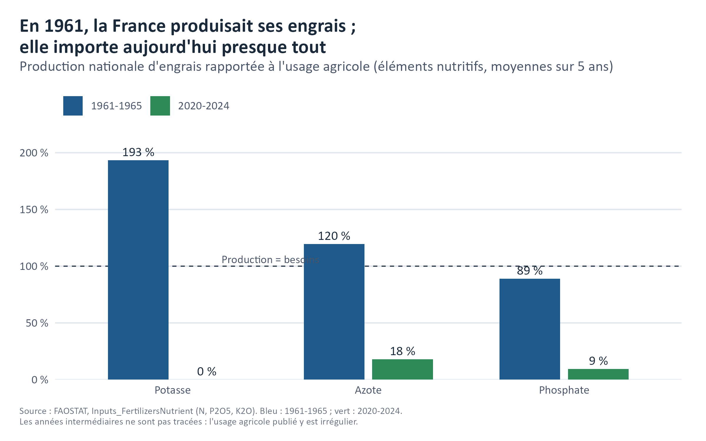
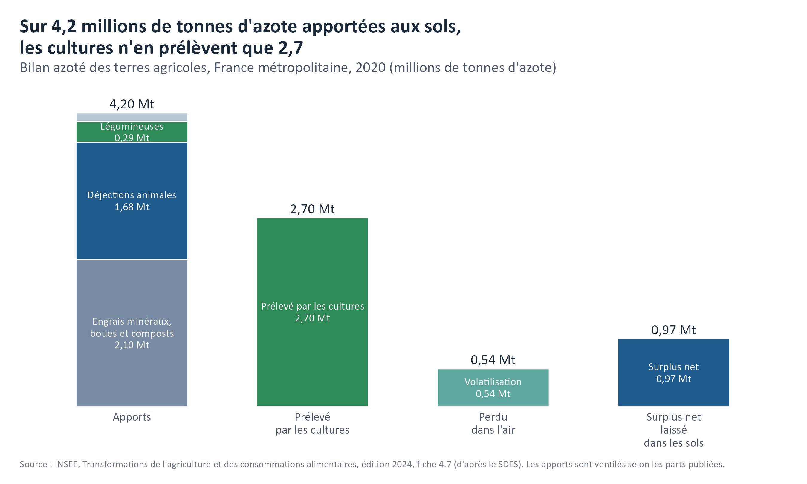
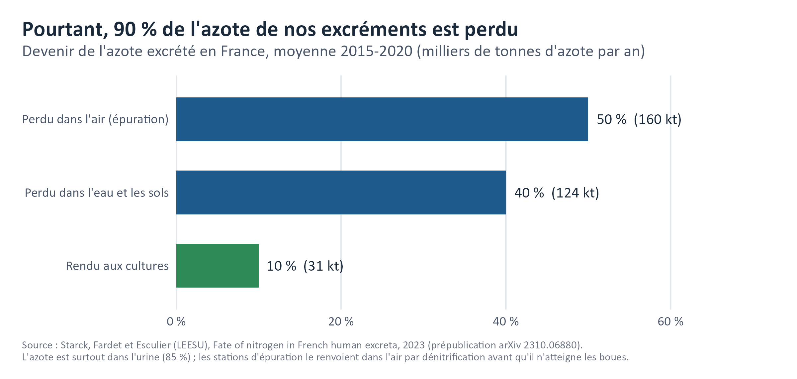
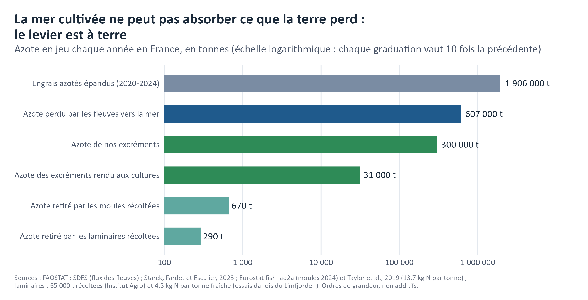
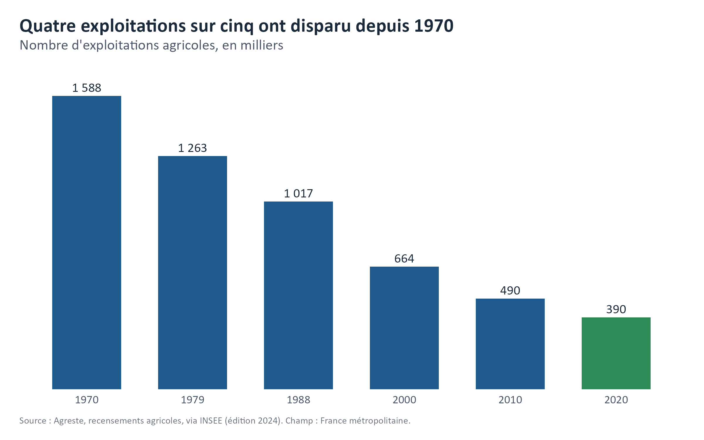
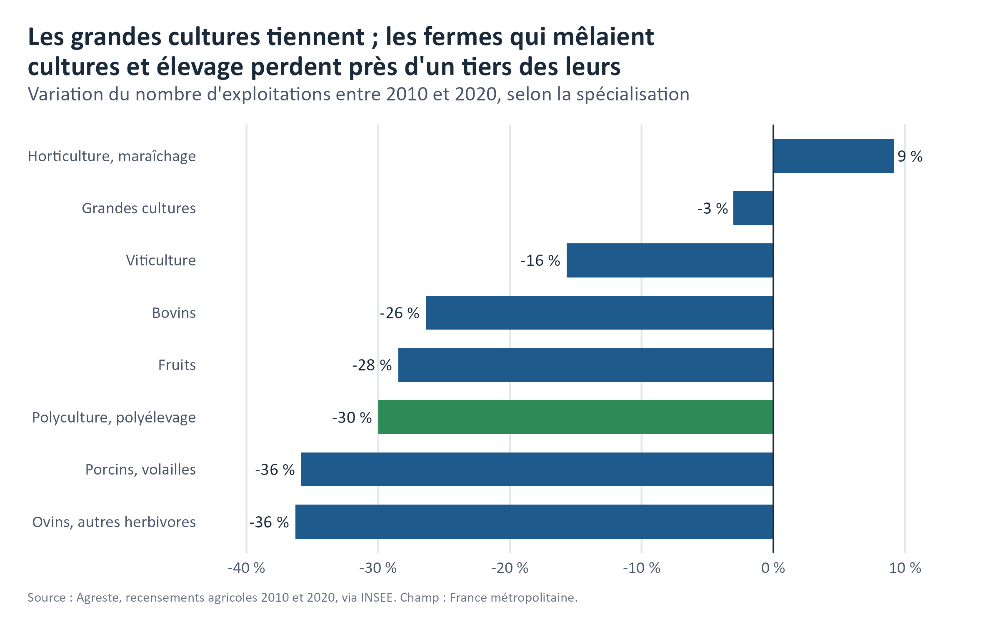
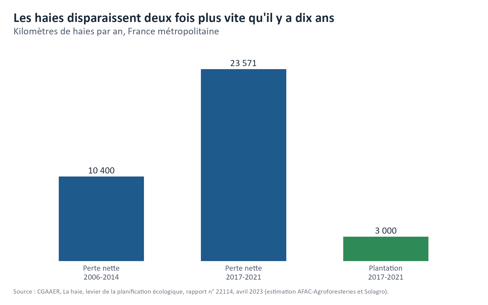

# La France et la terre : produire plus sur le même hectare, et ne plus rien perdre

Ce projet ne cherche pas à dresser l'inventaire d'un déclin, mais à chiffrer des solutions techniques. Il part de deux
constats : le rendement du blé ne progresse plus depuis trente ans, et la France importe désormais l'essentiel de ses
engrais. Il examine ensuite trois leviers en détail, avec leurs ordres de grandeur et leurs limites : l'agroforesterie, qui
produit davantage sur la même surface ; la récupération de l'azote que nos villes détruisent ; et la culture de la mer, qui
prolonge la terre sans engrais. Il passe enfin en revue d'autres leviers, souvent plus gros : les effluents d'élevage, les
légumineuses, les cultures intermédiaires et le phosphore des boues.

## 1. Le constat, en deux chiffres

**Le rendement plafonne.** Le blé français a gagné 0,12 t/ha chaque année entre le début des années 1960 et le milieu des
années 1990, passant de 2,9 à 6,6 t/ha. Depuis, il ne progresse plus : 6,8 t/ha en moyenne sur 2020-2024, soit 0,004 t/ha
de gain par an (FAOSTAT). On ne produira plus davantage en intensifiant la même technique.


**Les engrais viennent d'ailleurs.** Au début des années 1960, la France produisait 120 % de l'azote et 193 % de la potasse
qu'épandaient ses agriculteurs. Aujourd'hui, elle ne produit plus que 9 % du phosphate et aucune potasse ; pour l'azote,
la part produite en France est de 18 % selon FAOSTAT et d'environ 35 % selon FranceAgriMer (800 000 t produites pour
2 millions de tonnes consommées), la série de la FAO présentant une rupture vers 2012. Dans les deux cas, l'essentiel est
importé : tout gain de rendement obtenu par les engrais est un gain importé.



## La bonne dose : ce que serait l'agriculture 2.0

**L'azote n'est pas nocif pour les cultures : c'est l'élément dont elles ont le plus besoin.** Il entre dans les protéines et
dans la chlorophylle ; sans lui, ni croissance, ni rendement, ni blé assez riche en protéines pour la boulangerie. Le
triplement des rendements entre 1960 et 1995 lui doit beaucoup. Ce qui coûte, c'est l'excès. Le rendement répond à l'azote
selon une courbe qui plafonne : au-delà de la dose utile, la plante n'en tire plus rien, et l'excédent se paie. Le blé trop
nourri « verse », c'est-à-dire que sa tige trop longue se couche ; son feuillage dense et tendre attire maladies et pucerons ;
un sol riche en nitrates freine la fixation d'azote par les légumineuses ; et ce que la plante ne prend pas part vers les
nappes, les fleuves et l'air.

**L'excès est mesuré.** En 2020, 4,2 millions de tonnes d'azote ont été apportées aux terres agricoles françaises : pour
moitié des engrais minéraux, pour 40 % des déjections animales, le reste venant des légumineuses et de l'air. Les cultures
et les prairies n'en ont prélevé que 2,7 millions, soit 64 %. 540 000 tonnes se sont volatilisées, surtout sous forme
d'ammoniac, et 970 000 tonnes sont restées en excédent dans les sols, soit 33 kg par hectare (INSEE, 2024). Ce surplus est
de l'azote payé, apporté, et perdu.



**L'agriculture 2.0 n'est donc pas une agriculture sans azote, mais une agriculture qui met le bon azote, au bon moment, au
bon endroit.** Quatre principes en découlent, que les sections suivantes chiffrent :
1. **Mesurer avant d'apporter** : prévoir le besoin de la culture par un bilan, puis l'ajuster en cours de saison avec des
   capteurs ou des images satellites. Dans neuf essais menés en Centre-Val de Loire, la méthode APPI-N de l'INRAE et
   d'Arvalis a retardé le premier apport de seize jours et réduit la dose totale de 33 kg d'azote par hectare, sans
   changement significatif du rendement ni de la teneur en protéines.
2. **Fractionner et moduler** : plusieurs apports plutôt qu'un seul, et une dose qui varie d'un endroit à l'autre de la
   parcelle selon ce que le sol fournit déjà.
3. **Produire l'azote sur place** : légumineuses dans la rotation, effluents d'élevage mieux répartis, urine collectée.
4. **Le retenir** : racines profondes des arbres, cultures intermédiaires entre deux récoltes.

Le plafonnement des rendements n'appelle donc pas davantage d'engrais : il appelle un meilleur usage de ceux que l'on apporte
déjà, et des systèmes qui en produisent et en retiennent une partie eux-mêmes.

## 2. Premier levier : l'agroforesterie, ou produire plus sur le même hectare

**Le principe.** L'arbre et la culture n'exploitent pas les mêmes ressources au même endroit ni au même moment. Comme
l'explique Christian Dupraz, la céréale d'hiver assèche le sol de surface au printemps, ce qui oblige l'arbre à s'enraciner
plus profond, sous la culture. Sur 40 ans, d'après les simulations de l'INRAE, une parcelle de noyers et de blé intercepte 1,39 fois la lumière et valorise
1,55 fois l'eau d'une parcelle spécialisée.

**Le gain mesuré.** L'indicateur est la surface équivalente (*land equivalent ratio*, LER) : la surface qu'il faudrait,
arbres et cultures séparés, pour produire autant que l'hectare associé. Sur les parcelles de l'INRAE dirigées par Christian
Dupraz, il atteint **1,34 mesuré** (peupliers et céréales récoltés après 13 à 15 ans, Vézénobres, Gard) et **1,4 à 1,6
simulé** sur une rotation complète de noyers et de blé (Restinclières, Hérault). Cent hectares en agroforesterie produisent
autant de grain et de bois que 130 à 160 hectares séparés.


**Les paramètres techniques.** Les parcelles de l'INRAE comptent 80 noyers par hectare (Restinclières, 45 ha de céréales,
colza et pois) ou 140 peupliers par hectare, contre 200 en peupleraie pure (Vézénobres). Les rangées sont espacées pour
laisser passer les machines. Le bois n'est récolté qu'au bout de 15 à 50 ans selon l'essence : c'est un capital qui
mûrit, et non un revenu annuel.

**Le réseau profond.** Les racines des arbres descendent sous la zone exploitée par la culture et y interceptent les
nitrates qui, sinon, gagneraient la nappe puis les fleuves. L'INRAE modélise cet effet de « filet de sécurité » (projet
METAGROFORESTRY) ; aucune mesure chiffrée publique n'en donne encore l'ampleur à l'échelle d'une parcelle française.

**Ce qui existait déjà : la complantation.** Dans le Sud-Ouest, la joualle associait des rangs de vigne grimpant sur des
arbres fruitiers (cerisiers en Gironde, pruniers d'Ente en Lot-et-Garonne, abricotiers sur les coteaux du Lot et de la
Garonne) à des bandes de céréales, de légumes ou de fourrage. Ces cultures intercalaires ont été remplacées au milieu du XXe
siècle par le seul blé, puis le remembrement a fait disparaître les dernières joualles.

**Ce qui marche ailleurs à grande échelle : la dehesa.** En Espagne et au Portugal, environ 3,5 millions d'hectares de
prairies plantées de chênes donnent sur le même sol de l'herbe, du liège, du bois et des glands, que les porcs ibériques
viennent manger à l'automne ; leurs déjections fertilisent la prairie, et rien ne s'y perd. La filière « de bellota » est
encadrée par un décret de 2014 : au moins 46 kg pris à la glandée, en plus de 60 jours, et 0,25 à 1,25 porc par hectare au
plus selon la couverture des arbres. Environ 700 000 porcs étaient certifiés par saison au milieu des années 2010. La dehesa
produit peu par hectare et vit du prix du jambon : elle ne se transpose pas aux plaines céréalières, mais elle prouve qu'un
système agroforestier peut faire vivre une filière entière.

## 3. Deuxième levier : récupérer l'azote que la ville détruit

**L'idée est ancienne.** Victor Hugo l'écrivait en 1862 dans le chapitre des *Misérables* intitulé « La terre appauvrie par
la mer » : « Si notre or est fumier, en revanche, notre fumier est or. » Citant le chimiste Liebig, il ajoutait que « les
cloaques de Rome ont absorbé tout le bien-être du paysan romain ». La Cloaca Maxima a bien duré 2 500 ans, mais elle jetait
au Tibre ce que la campagne avait produit. Paris a appliqué le remède d'Hugo : vers 1910, plus de 5 000 hectares de
maraîchages à Gennevilliers, Achères, Méry-Pierrelaye et Carrières-Triel étaient arrosés par les eaux d'égout de la ville
(Dufour, *Métropolitiques*).

**Les boues sont déjà rendues au sol.** La France épand ou composte 88 % de ses boues d'épuration, contre 17 % en Allemagne
et aucune aux Pays-Bas ni en Suisse, qui les incinèrent (Eurostat, 2024). Sur ce point, elle fait mieux que ses voisins.


**Mais l'azote est perdu en route.** Il se trouve à 85 % dans l'urine, et les stations d'épuration le renvoient dans l'air
sous forme de diazote avant qu'il n'atteigne les boues. Sur environ 300 000 tonnes d'azote excrétées chaque année en France,
50 % partent dans l'air, 40 % dans l'eau ou les sols, et 10 % seulement reviennent aux cultures (Starck, Fardet et Esculier,
LEESU, 2023, prépublication). On dépense de l'énergie pour détruire un azote que l'on importe par ailleurs sous forme d'engrais.



**La solution technique : séparer l'urine à la source.** Collectée à part (toilettes à séparation, réseaux dédiés dans les
immeubles neufs), l'urine donne un engrais azoté aux propriétés proches des engrais de synthèse ; le programme OCAPI l'étudie
en Île-de-France. Tout récupérer remplacerait environ 15 % des engrais azotés de synthèse (12 % des besoins en azote total selon
FranceAgriMer). Ce n'est pas l'autonomie, mais c'est une deuxième usine d'engrais, déjà construite, qui s'appelle
une ville.

## 4. Troisième levier : cultiver la mer, sans engrais

**Cultiver des algues : la mer qui rend à la terre.** Les algues poussent sans engrais ni nourriture : elles puisent dans
l'eau l'azote et le phosphore que les fleuves y ont apportés. Récoltées, elles reviennent à la terre : le goémon a fertilisé
les champs bretons pendant des siècles, et l'on en tire aujourd'hui des amendements et des biostimulants. C'est la boucle
terre-mer-terre la plus directe. Une tonne d'algues fraîches emporte environ 4,5 kg d'azote (essais danois de laminaire
sucrée cultivée sur filières). La France reste pourtant cueilleuse plutôt que cultivatrice : elle récolte environ
65 000 tonnes de laminaires sauvages par an en Bretagne, surtout pour l'industrie, tandis que la culture sur filières y
reste marginale (quelques dizaines de tonnes au milieu des années 2010, 250 hectares autorisés en 2018). Les coquillages
jouent le même rôle de filtre : une tonne de moules récoltée retire environ 13,7 kg d'azote (Taylor et al., 2019), et la
France en produit près de 49 000 tonnes par an (Eurostat, 2024).

**Ce que la mer ne peut pas faire.** Les fleuves français portent chaque année environ 607 000 tonnes d'azote vers la mer
(SDES). Les laminaires et les moules récoltées en retirent environ 1 000 tonnes, soit 0,16 %. Pour capter 10 % de ces pertes
avec des algues seules, il faudrait en cultiver plus de 13 millions de tonnes par an, deux cents fois la récolte bretonne
actuelle. La mer cultivée est un complément, utile pour assainir une baie saturée, produire des protéines sans engrais et
rendre un peu d'azote aux champs ; elle n'est pas l'exutoire des pertes de la terre. Le levier,
c'est de garder l'azote à terre : par les racines des arbres, et par la récupération de l'urine.



## 5. D'autres leviers, souvent plus gros que l'urine

L'azote de nos excréments n'est pas le seul gisement, ni le plus important. D'autres leviers, moins connus du grand public,
pèsent autant ou davantage.

**Les effluents d'élevage : moins perdre ce qui est déjà épandu.** La France produit et collecte 108 millions de tonnes
de fumier et de lisier, qui contiennent 597 500 tonnes d'azote (FranceAgriMer, juin 2025). Mais 80 % sont déjà épandus :
ils remplacent déjà des engrais, et ne constituent pas un gisement nouveau. Le gisement, c'est ce qu'ils perdent. Sur les
540 000 tonnes d'azote qui partent chaque année dans l'air sous forme d'ammoniac, les deux tiers viennent des élevages
(INSEE), soit environ 360 000 tonnes, perdues dans les bâtiments, les fosses et surtout à l'épandage. Les techniques pour
les retenir existent : injecter le lisier dans le sol ou l'enfouir rapidement réduit ses pertes d'ammoniac de 70 à 90 %,
contre 30 à 60 % pour une rampe à pendillards (chambres d'agriculture, d'après l'ADEME). S'y ajoute une difficulté
logistique : les élevages et les terres qui manquent d'azote ne sont pas toujours au même endroit. C'est là que la
spécialisation des exploitations pèse : entre 2010 et 2020, la France a perdu 30 % de ses fermes de polyculture-élevage
(annexe), celles qui épandaient sur leurs champs le fumier de leurs bêtes.

**Les légumineuses : l'azote pris dans l'air, gratuitement.** Pois, féverole, luzerne et trèfle hébergent dans leurs racines
des bactéries qui fixent l'azote de l'air : 60 à 70 % de l'azote du pois en vient, environ 75 % pour la féverole, 90 % pour
la luzerne et le trèfle. Elles n'ont donc pas besoin d'engrais azoté, et en laissent au sol pour la culture suivante : un
blé semé après un pois demande 20 à 60 kg d'azote de moins par hectare (DRAAF Grand Est, d'après Terres Inovia). C'est la
technique qui a porté la révolution agricole du XVIIIe siècle, quand le trèfle a remplacé la jachère dans les assolements.

**Les cultures intermédiaires : un filet entre deux récoltes.** Semée entre la moisson et le semis suivant, une culture
« piège à nitrates » (moutarde, ray-grass, phacélie) absorbe l'azote resté dans le sol avant que les pluies d'hiver ne
l'emportent. L'INRA relève une baisse de la concentration en nitrate des eaux de drainage généralement supérieure à 50 %,
et souvent à 75 % en climat pluvieux. La technique a ses conditions : après un maïs grain récolté en octobre, elle n'a
presque aucun effet (moins de 10 %), faute de temps pour pousser (INRA, juin 2012). Retenu à la parcelle, cet azote ne part
pas vers les fleuves, puis vers la mer.

**Le phosphore des boues : ce que la Suisse et l'Allemagne imposent.** Le phosphore est la ressource la plus critique : la
France ne produit que 9 % du phosphate qu'épandent ses agriculteurs. La Suisse impose depuis le 1er janvier 2026 de
récupérer le phosphore des boues d'épuration, des farines animales et des poudres d'os ; l'Allemagne l'imposera à partir de
2029, notamment à partir des cendres de boues incinérées. Je n'ai pas trouvé d'obligation équivalente en France, où
l'épandage direct des boues en restitue déjà une partie aux sols.

**Les biodéchets.** Depuis le 1er janvier 2024, le tri à la source des biodéchets est obligatoire en France, ménages compris ;
le compost et le digestat qui en sont issus reviennent aux sols. Les collectivités françaises compostaient 114 kg de déchets
municipaux par habitant en 2024, contre 60 en 2000, et 174 en Autriche (Eurostat).

## 6. Ce que cela donne ensemble

| Levier | Gain chiffré | Délai | Limite principale |
|---|---|---|---|
| Agroforesterie | 1,3 à 1,6 fois la production d'un hectare spécialisé | 15 à 50 ans pour le bois | peu de mesures en vraie grandeur |
| Séparation de l'urine | jusqu'à 15 % des engrais azotés de synthèse | dès les constructions neuves | réseaux à créer, logistique de collecte |
| Mer cultivée | protéines sans engrais ; 1 000 t d'azote retirées | immédiat | ordre de grandeur sans rapport avec les pertes |
| Pertes d'ammoniac des élevages | jusqu'à 360 000 t d'azote par an ; 70 à 90 % évitables à l'épandage | immédiat | matériel d'épandage, coût, distance élevages-cultures |
| Légumineuses | 20 à 60 kg d'azote en moins par hectare sur le blé suivant | une rotation | débouchés et rendements à sécuriser |
| Cultures intermédiaires | nitrate des eaux de drainage réduit de plus de 50 % | une saison | inefficaces après un maïs grain |
| Phosphore des boues | ressource importée à plus de 90 % | 2026 en Suisse, 2029 en Allemagne | procédés encore coûteux |

La mer, le fleuve, puis la terre : dans chaque domaine, le savoir existe et il est souvent français, qu'il s'agisse de GTT
pour les cuves des méthaniers, de l'INRAE pour l'agroforesterie ou du LEESU pour l'azote. Ce qui manque n'est pas la
technique, mais sa mise en œuvre. Ce sera l'objet du projet suivant.

## Simulateur Power BI

Le dossier `powerbi/` contient un simulateur interactif (format PBIP, à ouvrir avec Power BI Desktop) qui pose une seule
question : **combien d'engrais azotés importés pourrait-on remplacer ?** Une grande jauge représente les 2 millions de tonnes
d'azote de synthèse consommées chaque année, remplies levier par levier ; trois chiffres donnent l'azote apporté, la part des
engrais remplacée et la comparaison avec la production française (800 000 t).


Deux scénarios. **« Maximum théorique »** : toute l'urine collectée (255 000 t d'azote) et toutes les pertes d'ammoniac des
élevages évitées (360 000 t), soit 615 000 t, 31 % des engrais azotés consommés et 77 % de la production française. C'est un
plafond, pas une promesse. **« Personnalisé »** : quatre curseurs règlent la part de l'urine collectée, la part des pertes
d'ammoniac évitées, les hectares de légumineuses en plus et les tonnes d'algues cultivées. Les légumineuses et les algues
n'entrent pas dans le maximum, faute de plafond sourcé. Une page compare les pays européens sur leurs boues d'épuration, une
autre liste chaque coefficient avec sa source. Exemple de scénario personnalisé ci-dessous : 40 % de l'urine collectée,
45 % des pertes d'ammoniac évitées, un million d'hectares de légumineuses en plus et 300 000 tonnes d'algues apportent
305 350 tonnes d'azote, soit 15 % des engrais azotés consommés.


Côté technique : chaque curseur est un paramètre de simulation (`GENERATESERIES`, `SELECTEDVALUE` avec valeur par défaut) ;
les coefficients sont des mesures constantes regroupées dans un dossier « Hypothèses », si bien qu'une hypothèse se change à
un seul endroit ; les pourcentages sont stockés en entiers (0 à 100) pour que le filtre d'un curseur retrouve toujours sa
valeur exacte ; les cartes affichent un texte déjà formaté (« 615 000 t ») plutôt que les abréviations par défaut. Les
calculs sont vérifiés par requêtes DAX sur le modèle.

## Limites

- **Le plateau du blé a plusieurs causes** (choix variétaux, réduction des intrants, aléas de récolte) ; ce projet le
  constate, il ne les départage pas.
- **Le LER mesuré l'a été sur peu de parcelles** : 1,34 provient d'un essai de peupliers ; 1,4 à 1,6 sont simulés.
- **L'usage agricole d'engrais publié par la FAO est irrégulier entre 2003 et 2014** ; seules les périodes 1961-1965 et
  2020-2024 sont comparées.
- **Le bilan de l'azote des excréments** porte sur 2015-2020, avec une part recyclée estimée entre 5 et 15 %. Le chiffre
  parfois cité d'un recyclage de 50 % de l'azote parisien vers 1904 n'a pas pu être vérifié à la source ; il n'est pas repris.
- **Les champs d'épandage ont laissé des sols pollués** au plomb, parce que les eaux mêlaient rejets domestiques et
  industriels (suivi de l'ARS Île-de-France). La séparation à la source répond aussi à ce problème.
- **Les coefficients marins sont des ordres de grandeur.** 13,7 kg d'azote par tonne vient de moules danoises dites « de
  compensation », récoltées jeunes ; les moules de bouchot françaises peuvent s'en écarter. 4,5 kg par tonne d'algues vient
  de deux essais danois de laminaire sucrée cultivée (environ 23 g d'azote pour 5,1 kg de biomasse par mètre de filière ;
  5 à 7 g pour 1,1 à 1,5 kg dans un essai antérieur), connus par leurs résumés, et appliqué ici aux laminaires sauvages.
- **Le bilan de l'azote des excréments est une prépublication** (arXiv, 2023), sans publication connue dans une revue à
  comité de lecture ; ses auteurs (LEESU, École des Ponts) sont toutefois les spécialistes français du sujet. Le flux des fleuves est une moyenne
  décennale publiée par le SDES. L'effet des huîtres n'est pas compté.
- **La dehesa est mal mesurée** : sa surface varie de 0,5 à plus de 3,5 millions d'hectares selon la définition ; le chiffre
  de 700 000 porcs date d'une saison du milieu des années 2010.
- **Production française d'engrais azotés : deux sources discordantes.** FAOSTAT donne 343 000 t (moyenne 2020-2024),
  FranceAgriMer 800 000 t (2025) ; la série FAO présente une rupture vers 2012. Le graphique des engrais repose sur FAOSTAT ;
  la potasse (0 %) et le phosphate (9 %) ne sont pas en cause.
- **Les leviers ne s'additionnent pas.** Effluents, urine, légumineuses et cultures intermédiaires portent sur des flux
  d'azote qui se recouvrent en partie ; leurs gains ne peuvent pas être sommés.
- **Les effluents déjà épandus ne sont pas comptés comme un levier** : ils remplacent déjà des engrais. Seules leurs
  pertes d'ammoniac le sont (environ 360 000 t, deux tiers des 540 000 t volatilisées selon l'INSEE). Les taux de réduction
  par injection ou enfouissement (70 à 90 %) viennent de fiches de chambres d'agriculture reprenant l'ADEME.
- **Deux mesures des déjections animales.** L'INSEE compte 1,68 million de tonnes d'azote dans les déjections (y compris au
  pâturage) ; FranceAgriMer, 597 500 tonnes dans les seuls fumiers et lisiers collectés. Les deux chiffres ne mesurent pas
  la même chose.
- **Le gain de la méthode APPI-N** repose sur neuf essais régionaux (2017-2019) ; il n'est pas généralisable tel quel.
- **La complantation historique n'est pas chiffrée** : aucune statistique ne mesure l'étendue passée des joualles.

## Annexe : le contexte en graphiques

Ces graphiques complètent le constat sans en être le cœur.

- Exploitations : 1,59 million en 1970, 390 000 en 2020 ; entre 2010 et 2020, −30 % pour la polyculture-élevage contre −3 %
  pour les grandes cultures (Agreste).
- Balance agricole hors vins et spiritueux : taux de couverture de 140 % en 1993, 99 % en 2024 ; fruits et légumes, 50 %
  (FAOSTAT).
- Haies : 70 % disparues depuis 1950 ; perte nette de 23 571 km par an entre 2017 et 2021, pour 3 000 km plantés (CGAAER).
- Industriels de l'aval (Bonduelle, Exel Industries, LDC, Savencia) : marges nettes de −5 % à +5 % (comptes publiés).

| | |
|---|---|
|  |  |
|  |  |
|  | |

## Reproduire

```
cd donnees && python extraire_fao.py && python extraire_eurostat.py && python extraire_boursorama.py && cd ..
Rscript analyse.R
```
Les scripts Python lisent les fichiers FAOSTAT (`donnees/brut/fao/`, non versionnés car volumineux), les fichiers JSON
Eurostat et les pages Boursorama enregistrés dans `donnees/brut/`. `analyse.R` écrit les graphiques et `resultats.txt`
dans `sorties/`. Packages R : dplyr, tidyr, ggplot2, scales. Le détail des sources figure dans `donnees/SOURCES.md`.

## Sources

- FAOSTAT : [production](https://www.fao.org/faostat/fr/#data/QCL), [échanges](https://www.fao.org/faostat/fr/#data/TCL),
  [engrais](https://www.fao.org/faostat/fr/#data/RFN).
- INRAE, [*Agroforesterie et agrivoltaïsme*](https://ciag.hub.inrae.fr/content/download/5447/41887?version=1) ;
  C. Dupraz, [texte du concours agro-véto 2023](https://www.concours-agro-veto.fr/sites/default/files/media/2025-10/sujet_paysage_2023.pdf) ;
  résultats de Restinclières et Vézénobres repris par la [Mission bocage](https://www.parc-loire-anjou-touraine.fr/sites/default/files/2020-04/journees-techniques-agroforesterie-definition-et-perspectives-mission-bocage.pdf) ;
  [METAGROFORESTRY](https://biosefair.hub.inrae.fr/media/files/fiche_resultats_metagroforestry).
- Joualles : [Wikipédia](https://fr.wikipedia.org/wiki/Joualle) ;
  [Les Vergers retrouvés du Comminges](https://www.les-vergers-retrouves-du-comminges.org/histoire/joualles-et-hautains/).
- Dehesa : [Real Decreto 4/2014](https://www.boe.es/buscar/act.php?id=BOE-A-2014-318) ;
  [Agronews Castilla y León](https://www.agronewscastillayleon.com/en-la-ultima-montanera-se-certificaron-703000-cochinos-ibericos-de-bellota), juillet 2017 ;
  surface : [Cuadernos Geográficos](https://revistaseug.ugr.es/index.php/cuadgeo/article/download/8641/9681).
- V. Hugo, *Les Misérables*, t. V, l. II, ch. 1, [« La terre appauvrie par la mer »](https://fr.wikisource.org/wiki/Les_Mis%C3%A9rables/Tome_5/Livre_2/01), 1862.
- É. Dufour, [*La persistance des champs d'épandage d'eaux usées de l'agglomération parisienne*](https://metropolitiques.eu/IMG/pdf/dufour.pdf), *Métropolitiques*.
- ARS Île-de-France, [*Les plaines d'épandage*](https://www.iledefrance.ars.sante.fr/les-plaines-depandage-controle-et-suivi-sanitaire-par-lagence).
- Eurostat : [env_ww_spd](https://ec.europa.eu/eurostat/databrowser/view/env_ww_spd/default/table) (boues),
  [fish_aq2a](https://ec.europa.eu/eurostat/databrowser/view/fish_aq2a/default/table) (aquaculture).
- T. Starck, T. Fardet, F. Esculier, [*Fate of nitrogen in French human excreta*](https://arxiv.org/abs/2310.06880), 2023.
- SDES, [flux d'azote des fleuves vers la mer](https://www.statistiques.developpement-durable.gouv.fr/flux-la-mer-trop-dazote-mais-moins-de-phosphore).
- D. Taylor, C. Saurel, P. Nielsen, J. K. Petersen, [*Production Characteristics and Optimization of Mitigation Mussel Culture*](https://www.frontiersin.org/articles/10.3389/fmars.2019.00698), *Frontiers in Marine Science*, 2019.
- Laminaire sucrée au Danemark : [*Commercial scale cultivation of Saccharina latissima in Denmark*](https://www.sciencedirect.com/science/article/pii/S2211926426002456) ;
  [*Commercial cultivation and bioremediation potential of sugar kelp in Danish waters*](https://link.springer.com/article/10.1007/s10811-014-0519-8), 2015 (résumés).
- Récolte de laminaires : [Institut Agro](https://halieutique.institut-agro.fr/files/fichiers/pdf/5897.pdf) ;
  [préfecture de Bretagne](https://www.prefectures-regions.gouv.fr/bretagne/irecontenu/telechargement/132451/972128/file/Note%20de%20pr%C3%A9sentation%20D%C3%A9lib%C3%A9ration%20ALGUES%20MESURES%20TECHNIQUES.pdf).
- FranceAgriMer, *Ressources en biomasse : quel potentiel de substitution des engrais de synthèse ?*, juin 2025, cité par
  [*Réussir*](https://www.reussir.fr/grandes-cultures/fertilisation-azotee-la-france-peut-elle-remplacer-les-engrais-mineraux-par-la-biomasse-organique), 9 juillet 2025.
- Légumineuses : DRAAF Grand Est, [*Fixer de l'azote par les légumineuses*](https://draaf.grand-est.agriculture.gouv.fr/IMG/pdf/gazote_2-202104-fixer_de_l_azote_par_les_legumineuses.pdf), 2021.
- INRA, [*Réduire les fuites de nitrate au moyen de cultures intermédiaires*](https://reseau-eau.educagri.fr/files/fichierRessource1_Etude_CIPAN-8pages_juin12.pdf), synthèse, juin 2012.
- Phosphore : OFEV (Suisse), [rapport explicatif sur l'ordonnance sur les déchets](https://www.bafu.admin.ch/dam/fr/sd-web/UP9nWLKjlIUr/Rapport%2Bexplicatif%2Bconcernant%2Bla%2Bmodification%2Bde%2Bl%E2%80%99ordonnance%2Bsur%2Bles%2Bd%C3%A9chets%2BOLED.pdf) ;
  [ville de Stuttgart](https://www.stuttgart.de/fr/pressemitteilungen/2024/maerz/gemeinsamer-schritt-zur-nachhaltigen-phosphorrueckgewinnung-aus-klaerschlammasche-im-suedwesten), mars 2024.
- INSEE, [*Évolution des surplus d'azote et de phosphore*](https://www.insee.fr/fr/statistiques/fichier/version-html/7728891/AGRI24-F27.pdf), fiche 4.7, *Transformations de l'agriculture et des consommations alimentaires*, édition 2024.
- Pilotage de l'azote : C. Baudart, [« De nouvelles méthodes pour piloter l'apport d'azote en temps réel »](https://www.reussir.fr/grandes-cultures/de-nouvelles-methodes-pour-piloter-lapport-dazote-en-temps-reel), *Réussir Grandes cultures*, 31 décembre 2019 (méthode APPI-N, INRAE et Arvalis).
- Annexe : [INSEE](https://www.insee.fr/fr/statistiques/7728861) ; [CGAAER](https://agriculture.gouv.fr/telecharger/136479) ;
  [Académie d'agriculture](https://academie-agriculture.fr/sites/default/files/publications/encyclopedie/commerce_exterieur_agroalimentaire.pdf) ;
  [Boursorama](https://www.boursorama.com).
