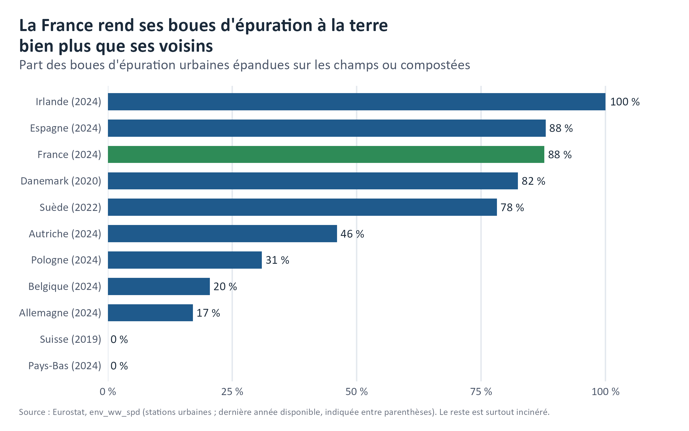

# La France et la terre : produire plus sur le même hectare, et ne plus rien perdre

Ce projet ne cherche pas à dresser l'inventaire d'un déclin, mais à chiffrer des solutions techniques. Il part de deux
constats : le rendement du blé ne progresse plus depuis trente ans, et la France importe désormais l'essentiel de ses
engrais. Il examine ensuite trois leviers, avec leurs ordres de grandeur et leurs limites : l'agroforesterie, qui produit
davantage sur la même surface ; la récupération de l'azote que nos villes détruisent ; et la culture de la mer, qui prolonge
la terre sans engrais.

## 1. Le constat, en deux chiffres

**Le rendement plafonne.** Le blé français a gagné 0,12 t/ha chaque année entre le début des années 1960 et le milieu des
années 1990, passant de 2,9 à 6,6 t/ha. Depuis, il ne progresse plus : 6,8 t/ha en moyenne sur 2020-2024, soit 0,004 t/ha
de gain par an (FAOSTAT). On ne produira plus davantage en intensifiant la même technique.


**Les engrais viennent d'ailleurs.** Au début des années 1960, la France produisait 120 % de l'azote et 193 % de la potasse
qu'épandaient ses agriculteurs. En 2020-2024, elle ne produit plus que 18 % de l'azote, 9 % du phosphate et aucune potasse ;
environ 1,9 million de tonnes d'azote sont épandues chaque année (FAOSTAT). Tout gain de rendement obtenu par les engrais
est donc un gain importé.


## 2. Premier levier : l'agroforesterie, ou produire plus sur le même hectare

**Le principe.** L'arbre et la culture n'exploitent pas les mêmes ressources au même endroit ni au même moment. La céréale
d'hiver pousse avant que le noyer ne prenne ses feuilles ; les racines de l'arbre descendent sous celles de la culture. Sur
40 ans, d'après les simulations de l'INRAE, une parcelle de noyers et de blé intercepte 1,39 fois la lumière et valorise
1,55 fois l'eau d'une parcelle spécialisée.

**Le gain mesuré.** L'indicateur est la surface équivalente (*land equivalent ratio*, LER) : la surface qu'il faudrait,
arbres et cultures séparés, pour produire autant que l'hectare associé. Sur les parcelles de l'INRAE dirigées par Christian
Dupraz, il atteint **1,34 mesuré** (peupliers et céréales récoltés après 13 à 15 ans, Vézénobres, Gard) et **1,4 à 1,6
simulé** sur une rotation complète de noyers et de blé (Restinclières, Hérault). Cent hectares en agroforesterie produisent
autant de grain et de bois que 130 à 160 hectares séparés.


**Les paramètres techniques.** Les parcelles de l'INRAE comptent 80 noyers par hectare (Restinclières, 45 ha de céréales,
colza et pois) ou 140 peupliers par hectare, contre 200 en peupleraie pure (Vézénobres). Les rangées sont espacées pour
laisser passer les machines. Le bois n'est récolté qu'au bout de 15 à 50 ans selon l'essence : c'est un capital qui
mûrit, et non un revenu annuel.

**Le réseau profond.** Les racines des arbres descendent sous la zone exploitée par la culture et y interceptent les
nitrates qui, sinon, gagneraient la nappe puis les fleuves. L'INRAE modélise cet effet de « filet de sécurité » (projet
METAGROFORESTRY) ; aucune mesure chiffrée publique n'en donne encore l'ampleur à l'échelle d'une parcelle française.

**Ce qui existait déjà : la complantation.** Dans le Sud-Ouest, la joualle associait des rangs de vigne grimpant sur des
arbres fruitiers (cerisiers en Gironde, pruniers d'Ente en Lot-et-Garonne, abricotiers sur les coteaux du Lot et de la
Garonne) à des bandes de céréales, de légumes ou de fourrage. Ces cultures intercalaires ont été remplacées au milieu du XXe
siècle par le seul blé, puis le remembrement a fait disparaître les dernières joualles.

**Ce qui marche ailleurs à grande échelle : la dehesa.** En Espagne et au Portugal, environ 3,5 millions d'hectares de
prairies plantées de chênes donnent sur le même sol de l'herbe, du liège, du bois et des glands, que les porcs ibériques
viennent manger à l'automne ; leurs déjections fertilisent la prairie, et rien ne s'y perd. La filière « de bellota » est
encadrée par un décret de 2014 : au moins 46 kg pris à la glandée, en plus de 60 jours, et 0,25 à 1,25 porc par hectare au
plus selon la couverture des arbres. Environ 700 000 porcs étaient certifiés par saison au milieu des années 2010. La dehesa
produit peu par hectare et vit du prix du jambon : elle ne se transpose pas aux plaines céréalières, mais elle prouve qu'un
système agroforestier peut faire vivre une filière entière.

## 3. Deuxième levier : récupérer l'azote que la ville détruit

**L'idée est ancienne.** Victor Hugo l'écrivait en 1862 dans le chapitre des *Misérables* intitulé « La terre appauvrie par
la mer » : « Si notre or est fumier, en revanche, notre fumier est or. » Citant le chimiste Liebig, il ajoutait que « les
cloaques de Rome ont absorbé tout le bien-être du paysan romain ». La Cloaca Maxima a bien duré 2 500 ans, mais elle jetait
au Tibre ce que la campagne avait produit. Paris a appliqué le remède d'Hugo : vers 1910, plus de 5 000 hectares de
maraîchages à Gennevilliers, Achères, Méry-Pierrelaye et Carrières-Triel étaient arrosés par les eaux d'égout de la ville
(Dufour, *Métropolitiques*).

**Les boues sont déjà rendues au sol.** La France épand ou composte 88 % de ses boues d'épuration, contre 17 % en Allemagne
et aucune aux Pays-Bas ni en Suisse, qui les incinèrent (Eurostat, 2024). Sur ce point, elle fait mieux que ses voisins.



**Mais l'azote est perdu en route.** Il se trouve à 85 % dans l'urine, et les stations d'épuration le renvoient dans l'air
sous forme de diazote avant qu'il n'atteigne les boues. Sur environ 300 000 tonnes d'azote excrétées chaque année en France,
50 % partent dans l'air, 40 % dans l'eau ou les sols, et 10 % seulement reviennent aux cultures (Starck, Fardet et Esculier,
LEESU, 2023). On dépense de l'énergie pour détruire un azote que l'on importe par ailleurs sous forme d'engrais.


**La solution technique : séparer l'urine à la source.** Collectée à part (toilettes à séparation, réseaux dédiés dans les
immeubles neufs), l'urine donne un engrais azoté aux propriétés proches des engrais de synthèse ; le programme OCAPI l'étudie
en Île-de-France. Tout récupérer remplacerait environ 15 % des engrais azotés de synthèse, soit à peu près ce que la France
produit encore elle-même. Ce n'est pas l'autonomie, mais c'est une deuxième usine d'engrais, déjà construite, qui s'appelle
une ville.

## 4. Troisième levier : cultiver la mer, sans engrais

**Ce que la mer peut faire.** Moules, huîtres et algues sont les seules productions alimentaires qui ne demandent ni engrais
ni nourriture : elles se nourrissent de ce que l'eau contient déjà. Chaque tonne de moules récoltée retire 13,7 kg d'azote
de la mer (Taylor et al., 2019) ; chaque tonne d'algues fraîches, environ 4,5 kg (essais danois du Limfjorden). Les algues
reviennent ensuite à la terre : le goémon a fertilisé les champs bretons pendant des siècles, et l'on en tire aujourd'hui
des biostimulants. La France récolte environ 65 000 tonnes de laminaires par an et produit près de 49 000 tonnes de moules
(Eurostat, 2024), quand la Norvège élève neuf fois plus de poissons et coquillages que nous (projet précédent).

**Ce qu'elle ne peut pas faire.** Les fleuves français portent chaque année environ 607 000 tonnes d'azote vers la mer
(SDES). Les moules et les laminaires récoltées en retirent environ 1 000 tonnes, soit 0,16 %. Pour en capter seulement 10 %,
il faudrait multiplier par plus de soixante la production actuelle. La mer cultivée est un complément, utile pour assainir
une baie saturée ou pour produire des protéines sans engrais ; elle n'est pas l'exutoire des pertes de la terre. Le levier,
c'est de garder l'azote à terre : par les racines des arbres, et par la récupération de l'urine.


## 5. Ce que cela donne ensemble

| Levier | Gain chiffré | Délai | Limite principale |
|---|---|---|---|
| Agroforesterie | 1,3 à 1,6 fois la production d'un hectare spécialisé | 15 à 50 ans pour le bois | peu de mesures en vraie grandeur |
| Séparation de l'urine | jusqu'à 15 % des engrais azotés de synthèse | dès les constructions neuves | réseaux à créer, logistique de collecte |
| Mer cultivée | protéines sans engrais ; 1 000 t d'azote retirées | immédiat | ordre de grandeur sans rapport avec les pertes |

La mer, le fleuve, puis la terre : dans chaque domaine, le savoir existe et il est souvent français, qu'il s'agisse de GTT
pour les cuves des méthaniers, de l'INRAE pour l'agroforesterie ou du LEESU pour l'azote. Ce qui manque n'est pas la
technique, mais sa mise en œuvre. Ce sera l'objet du projet suivant.

## Limites

- **Le plateau du blé a plusieurs causes** (choix variétaux, réduction des intrants, aléas de récolte) ; ce projet le
  constate, il ne les départage pas.
- **Le LER mesuré l'a été sur peu de parcelles** : 1,34 provient d'un essai de peupliers ; 1,4 à 1,6 sont simulés.
- **L'usage agricole d'engrais publié par la FAO est irrégulier entre 2003 et 2014** ; seules les périodes 1961-1965 et
  2020-2024 sont comparées.
- **Le bilan de l'azote des excréments** porte sur 2015-2020, avec une part recyclée estimée entre 5 et 15 %. Le chiffre
  parfois cité d'un recyclage de 50 % de l'azote parisien vers 1904 n'a pas pu être vérifié à la source ; il n'est pas repris.
- **Les champs d'épandage ont laissé des sols pollués** au plomb, parce que les eaux mêlaient rejets domestiques et
  industriels (suivi de l'ARS Île-de-France). La séparation à la source répond aussi à ce problème.
- **Les coefficients marins sont des ordres de grandeur** : 13,7 kg d'azote par tonne de moules (essais danois), 4,5 kg par
  tonne d'algues (laminaire sucrée cultivée, appliquée ici aux laminaires sauvages). Le flux des fleuves est une moyenne
  décennale publiée par le SDES. L'effet des huîtres n'est pas compté.
- **La dehesa est mal mesurée** : sa surface varie de 0,5 à plus de 3,5 millions d'hectares selon la définition ; le chiffre
  de 700 000 porcs date d'une saison du milieu des années 2010.
- **La complantation historique n'est pas chiffrée** : aucune statistique ne mesure l'étendue passée des joualles.

## Annexe : le contexte en graphiques

Ces graphiques complètent le constat sans en être le cœur.

- Exploitations : 1,59 million en 1970, 390 000 en 2020 ; entre 2010 et 2020, −30 % pour la polyculture-élevage contre −3 %
  pour les grandes cultures (Agreste).
- Balance agricole hors vins et spiritueux : taux de couverture de 140 % en 1993, 99 % en 2024 ; fruits et légumes, 50 %
  (FAOSTAT).
- Haies : 70 % disparues depuis 1950 ; perte nette de 23 571 km par an entre 2017 et 2021, pour 3 000 km plantés (CGAAER).
- Industriels de l'aval (Bonduelle, Exel Industries, LDC, Savencia) : marges nettes de −5 % à +5 % (comptes publiés).

| | |
|---|---|
|  |  |
|  |  |
|  | |

## Reproduire

```
cd donnees && python extraire_fao.py && python extraire_eurostat.py && python extraire_boursorama.py && cd ..
Rscript analyse.R
```
Les scripts Python lisent les fichiers FAOSTAT (`donnees/brut/fao/`, non versionnés car volumineux), les fichiers JSON
Eurostat et les pages Boursorama enregistrés dans `donnees/brut/`. `analyse.R` écrit les graphiques et `resultats.txt`
dans `sorties/`. Packages R : dplyr, tidyr, ggplot2, scales. Le détail des sources figure dans `donnees/SOURCES.md`.

## Sources

- FAOSTAT : [production](https://www.fao.org/faostat/fr/#data/QCL), [échanges](https://www.fao.org/faostat/fr/#data/TCL),
  [engrais](https://www.fao.org/faostat/fr/#data/RFN).
- INRAE, [*Agroforesterie et agrivoltaïsme*](https://ciag.hub.inrae.fr/content/download/5447/41887?version=1) ;
  C. Dupraz, [texte du concours agro-véto 2023](https://www.concours-agro-veto.fr/sites/default/files/media/2025-10/sujet_paysage_2023.pdf) ;
  résultats de Restinclières et Vézénobres repris par la [Mission bocage](https://www.parc-loire-anjou-touraine.fr/sites/default/files/2020-04/journees-techniques-agroforesterie-definition-et-perspectives-mission-bocage.pdf) ;
  [METAGROFORESTRY](https://biosefair.hub.inrae.fr/media/files/fiche_resultats_metagroforestry).
- Joualles : [Wikipédia](https://fr.wikipedia.org/wiki/Joualle) ;
  [Les Vergers retrouvés du Comminges](https://www.les-vergers-retrouves-du-comminges.org/histoire/joualles-et-hautains/).
- Dehesa : [Real Decreto 4/2014](https://www.boe.es/buscar/act.php?id=BOE-A-2014-318) ;
  [Agronews Castilla y León](https://www.agronewscastillayleon.com/en-la-ultima-montanera-se-certificaron-703000-cochinos-ibericos-de-bellota), juillet 2017 ;
  surface : [Cuadernos Geográficos](https://revistaseug.ugr.es/index.php/cuadgeo/article/download/8641/9681).
- V. Hugo, *Les Misérables*, t. V, l. II, ch. 1, [« La terre appauvrie par la mer »](https://fr.wikisource.org/wiki/Les_Mis%C3%A9rables/Tome_5/Livre_2/01), 1862.
- É. Dufour, [*La persistance des champs d'épandage d'eaux usées de l'agglomération parisienne*](https://metropolitiques.eu/IMG/pdf/dufour.pdf), *Métropolitiques*.
- ARS Île-de-France, [*Les plaines d'épandage*](https://www.iledefrance.ars.sante.fr/les-plaines-depandage-controle-et-suivi-sanitaire-par-lagence).
- Eurostat : [env_ww_spd](https://ec.europa.eu/eurostat/databrowser/view/env_ww_spd/default/table) (boues),
  [fish_aq2a](https://ec.europa.eu/eurostat/databrowser/view/fish_aq2a/default/table) (aquaculture).
- T. Starck, T. Fardet, F. Esculier, [*Fate of nitrogen in French human excreta*](https://arxiv.org/abs/2310.06880), 2023.
- SDES, [flux d'azote des fleuves vers la mer](https://www.statistiques.developpement-durable.gouv.fr/flux-la-mer-trop-dazote-mais-moins-de-phosphore).
- M. Taylor, C. Saurel, P. Nielsen, J. K. Petersen, [*Production characteristics and optimization of mitigation mussel culture*](https://www.frontiersin.org/articles/10.3389/fmars.2019.00698), *Frontiers in Marine Science*, 2019.
- Laminaire sucrée au Danemark : [*Commercial scale cultivation of Saccharina latissima in Denmark*](https://www.sciencedirect.com/science/article/pii/S2211926426002456).
- Récolte de laminaires : [Institut Agro](https://halieutique.institut-agro.fr/files/fichiers/pdf/5897.pdf) ;
  [préfecture de Bretagne](https://www.prefectures-regions.gouv.fr/bretagne/irecontenu/telechargement/132451/972128/file/Note%20de%20pr%C3%A9sentation%20D%C3%A9lib%C3%A9ration%20ALGUES%20MESURES%20TECHNIQUES.pdf).
- Annexe : [INSEE](https://www.insee.fr/fr/statistiques/7728861) ; [CGAAER](https://agriculture.gouv.fr/telecharger/136479) ;
  [Académie d'agriculture](https://academie-agriculture.fr/sites/default/files/publications/encyclopedie/commerce_exterieur_agroalimentaire.pdf) ;
  [Boursorama](https://www.boursorama.com).
